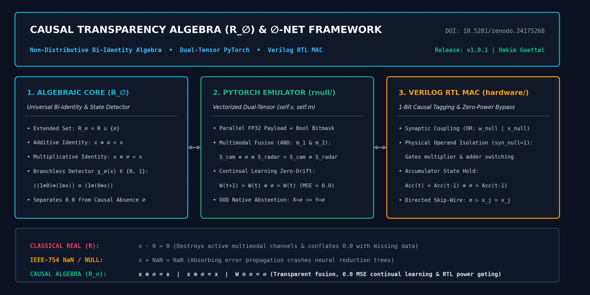
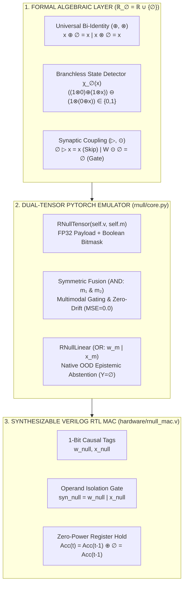
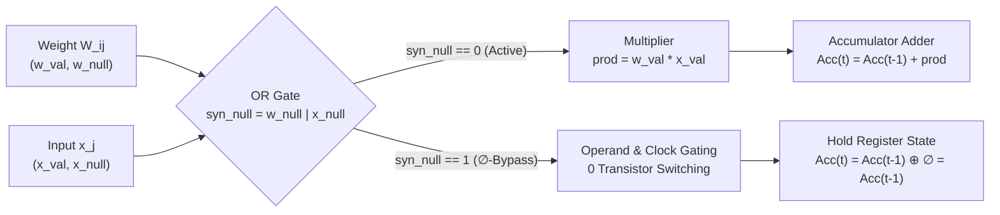

<div align="center">

# Causal Transparency Algebra ($\mathbb{R}_\emptyset$) & $\emptyset$-Net Framework

**Non-Distributive Bi-Identity Algebra • Vectorized Dual-Tensor PyTorch Emulator • Zero-Power Verilog RTL MAC**

[](https://doi.org/10.5281/zenodo.24175268)
[](https://github.com/GuettHM/rnull-framework/releases/tag/v1.0.1)
[](https://opensource.org/licenses/MIT)
[](https://www.python.org/downloads/)
[](https://pytorch.org/)
[](hardware/rnull_mac.v)

**Author:** Hakim Guettal &nbsp;|&nbsp; **Persistent DOI:** [10.5281/zenodo.24175268](https://doi.org/10.5281/zenodo.24175268) &nbsp;|&nbsp; **Version:** `v1.0.1`

[Overview](#1-overview--architectural-scope) •
[Mathematical Formulation](#2-mathematical-formulation-mathbbR_emptyset) •
[RTL Hardware Circuit](#23-synaptic-propagation-operators-rhd-and-odot--hardware-bypass) •
[Quick Start](#5-quick-start--reproducibility) •
[Cite](#6-how-to-cite)

<br>



</div>

---

## 1. Overview & Architectural Scope

Standard computational systems suffer from a foundational algebraic flaw: conflating **measured numerical zero ($0 \in \mathbb{R}$)** with the **complete absence of causal information ($\emptyset \notin \mathbb{R}$)**. In IEEE-754 arithmetic, zero destroys multiplicative layers ($x \cdot 0 = 0$), while `NaN` causes catastrophic failure propagation ($x + \text{NaN} = \text{NaN}$).

The **Causal Transparency Algebra ($\mathbb{R}_\emptyset$)** and **$\emptyset$-Net Framework** (`rnull-framework`) resolve these limitations across three strictly aligned levels:

1. **Formal Algebraic Level ($\mathbb{R}_\emptyset = \mathbb{R} \cup \lbrace \emptyset \rbrace$):** Defines a closed non-distributive algebraic structure equipped with symmetric **Universal Bi-Identity operators ($\oplus, \otimes$)**, an exact **Algebraic State Detector ($\chi_\emptyset$)**, a **Directed Synaptic Skip operator ($\rhd$)**, and an **Absorbing Synaptic MAC operator ($\odot$)**.
2. **Vectorized Dual-Tensor PyTorch Emulator (`rnull/`):** Because commodity CPUs and GPUs operate on dense IEEE-754 pipelines without physical `Hi-Z` lines, `RNullTensor` pairs a dense FP32 payload (`self.v`) with a boolean causal bitmask (`self.m` $\equiv \chi_\emptyset$) processed in parallel via SIMD/CUDA primitives (`torch.where`).
3. **Synthesizable Hardware Architecture (`hardware/`):** Realizes the physical **Zero-Power Computation Bypass** in Verilog RTL by mapping $\emptyset$ to a 1-bit hardware tag (`is_null`) that gates combinatorial multiplier and accumulator switching.

### Visual System Architecture (Mermaid Diagram)



---

## 2. Mathematical Formulation ($\mathbb{R}_\emptyset$)

Let $\mathbb{R}_\emptyset = \mathbb{R} \cup \lbrace \emptyset \rbrace$ be the extended set of real numbers equipped with the formal epistemic abstention element $\emptyset$.

### 2.1 Axiomatic Foundation & Universal Bi-Identity ($\oplus, \otimes$)

Unlike classical ring theory where additive ($0$) and multiplicative ($1$) identities remain separate, $\emptyset$ acts as a **Universal Bilateral Identity** for both extended addition ($\oplus$) and extended multiplicative fusion ($\otimes$):

* **Axiom 1 (Bilateral Neutrality — Logical `AND` on masks `self.m & other.m`):**

$$
\forall x \in \mathbb{R}_\emptyset: \quad x \oplus \emptyset = \emptyset \oplus x = x \quad \land \quad x \otimes \emptyset = \emptyset \otimes x = x
$$

* **Axiom 2 (Quotient Collapse & Subtractive Neutrality):**

$$
\forall x \in \mathbb{R}_\emptyset: \quad x \ominus \emptyset = x, \quad \emptyset \ominus x = -x, \quad x \oslash \emptyset = \emptyset \oslash x = \emptyset
$$

> [!IMPORTANT]
> **Multimodal Sensor Resilience:** This bi-identity structure allows multiplicative sensor fusion layers ($S_{\text{cam}} \otimes S_{\text{lidar}} \otimes S_{\text{radar}}$) to bypass an offline sensor ($S_{\text{lidar}} = \emptyset$) transparently ($S_{\text{cam}} \otimes \emptyset \otimes S_{\text{radar}} = S_{\text{cam}} \otimes S_{\text{radar}}$), while additive accumulations ignore missing pathways ($x_1 \oplus \emptyset \oplus x_3 = x_1 \oplus x_3$).

### 2.2 The Causal Clock & Algebraic State Detector $\chi_\emptyset(x)$

In $\mathbb{R}_\emptyset$, the controlled interaction between $0$ and $\emptyset$ breaks classical distributivity deliberately:

$$
a \otimes (0 \oplus \emptyset) = a \otimes 0 = 0 \quad \neq \quad (a \otimes 0) \oplus (a \otimes \emptyset) = 0 \oplus a = a \qquad (\forall a \in \mathbb{R} \setminus \lbrace 0 \rbrace)
$$

Setting $a = 1$ yields the **Causal Defect Functional $\chi_\emptyset(x)$** using solely the basic operators $(\oplus, \ominus, \otimes)$:

$$
\chi_\emptyset(x) \triangleq \big((1 \otimes 0) \oplus (1 \otimes x)\big) \ominus \big(1 \otimes (0 \oplus x)\big) = \begin{cases}
(0 + x) - (1 \cdot x) = 0 & \forall x \in \mathbb{R} \text{ (including } x = 0\text{)} \\
(0 \oplus 1) \ominus (1 \otimes 0) = 1 - 0 = 1 & \text{if } x = \emptyset
\end{cases}
$$

### 2.3 Synaptic Propagation Operators ($\rhd$ and $\odot$) & Hardware Bypass

In neural layers and hardware Multiply-Accumulate (MAC) units, interactions between weight $W_{ij}$ and input $x_j$ follow two dedicated synaptic operators:

* **Directed Synaptic Coupling ($\rhd$ — Native Skip-Wire vs. Input Abstention):**

$$
W_{ij} \rhd x_j \triangleq \begin{cases}
W_{ij} \otimes x_j & \text{if } \chi_\emptyset(x_j) = 0 \;\; (x_j \in \mathbb{R}) \\
\emptyset & \text{if } \chi_\emptyset(x_j) = 1 \;\; (x_j = \emptyset)
\end{cases}
$$

  1. **Native Skip-Connection ($W_{ij} = \emptyset, \, x_j \in \mathbb{R}$):** $W_{ij} \rhd x_j = \emptyset \otimes x_j = x_j$ (passive wire passthrough).
  2. **Native Epistemic Abstention ($x_j = \emptyset$):** $W_{ij} \rhd \emptyset = \emptyset$ (synapse abstains).

* **Absorbing Synaptic MAC Coupling ($\odot$ — Logical `OR` on masks `w.m | x.m`):**

$$
W_{ij} \odot x_j = \begin{cases}
W_{ij} \cdot x_j & \text{if } W_{ij}, x_j \in \mathbb{R} \\
\emptyset & \text{if } W_{ij} = \emptyset \text{ or } x_j = \emptyset
\end{cases} \qquad \Longrightarrow \qquad y_i = \bigoplus_{j=1}^{N} \left( W_{ij} \odot x_j \right)
$$

#### Verilog RTL Zero-Power $\emptyset$-Bypass Datapath (`hardware/rnull_mac.v`)



### 2.4 Operational Cayley Tables

| $\oplus$ (Additive Bi-Identity) | $b \in \mathbb{R} \setminus \lbrace 0 \rbrace$ | $0$ | $\emptyset$ |
| :--- | :---: | :---: | :---: |
| **$a \in \mathbb{R} \setminus \lbrace 0 \rbrace$** | $a + b$ | $a$ | $a$ |
| **$0$** | $b$ | $0$ | $0$ |
| **$\emptyset$** | $b$ | $0$ | $\emptyset$ |

| $\otimes$ (Multiplicative Bi-Identity) | $b \in \mathbb{R} \setminus \lbrace 0, 1 \rbrace$ | $1$ | $0$ | $\emptyset$ |
| :--- | :---: | :---: | :---: | :---: |
| **$a \in \mathbb{R} \setminus \lbrace 0, 1 \rbrace$** | $a \cdot b$ | $a$ | $0$ | $a$ |
| **$1$** | $b$ | $1$ | $0$ | $1$ |
| **$0$** | $0$ | $0$ | $0$ | $0$ |
| **$\emptyset$** | $b$ | $1$ | $0$ | $\emptyset$ |

| $W \rhd x$ (Directed Synaptic Skip) | Input $x \in \mathbb{R} \setminus \lbrace 0 \rbrace$ | Input $x = 0$ | Input $x = \emptyset$ |
| :--- | :---: | :---: | :---: |
| **Weight $W \in \mathbb{R} \setminus \lbrace 0 \rbrace$** | $W \cdot x$ | $0$ | $\emptyset$ |
| **Weight $W = 0$** | $0$ | $0$ | $\emptyset$ |
| **Weight $W = \emptyset$ (Skip-Wire)** | $x$ | $0$ | $\emptyset$ |

| $W \odot x$ (Absorbing MAC Synapse) | Input $x \in \mathbb{R} \setminus \lbrace 0 \rbrace$ | Input $x = 0$ | Input $x = \emptyset$ |
| :--- | :---: | :---: | :---: |
| **Weight $W \in \mathbb{R} \setminus \lbrace 0 \rbrace$** | $W \cdot x$ | $0$ | $\emptyset$ |
| **Weight $W = 0$** | $0$ | $0$ | $\emptyset$ |
| **Weight $W = \emptyset$ (Pruned)** | $\emptyset$ | $\emptyset$ | $\emptyset$ |

---

## 3. Structural Comparison Matrix

| Technical Property | Classical Real Arithmetic ($\mathbb{R}$) | IEEE-754 `NaN` / SQL `NULL` | Causal Transparency ($\mathbb{R}_\emptyset$) |
| :--- | :--- | :--- | :--- |
| **Identity Topology** | $0$ for addition, $1$ for multiplication | Destructive absorbing element | Universal Bi-Identity ($x \oplus \emptyset = x, \, x \otimes \emptyset = x$) |
| **Multiplicative Gating** | $x \cdot 0 = 0$ (Destroys active signal) | $x \cdot \text{NaN} = \text{NaN}$ (Graph crash) | $x \otimes \emptyset = x$ (Transparent passthrough) |
| **Synaptic Coupling** | $W \cdot 0 = 0$ (Conflates zero & absence) | `NaN` corrupts entire layer | $\emptyset \rhd x = x$ (Skip) / $W \odot \emptyset = \emptyset$ (MAC Gate) |
| **State Detection** | Requires comparator / branch | Requires bitwise `isnan` checks | Algebraic polynomial $\chi_\emptyset(x) \in \lbrace 0, 1 \rbrace$ |
| **Hardware Execution** | Dense FP32 MAC switching | Not supported for gating | RTL 1-bit `is_null` clock/operand bypass |
| **Continual Weight Update** | Eroded by Weight Decay & Momentum | Corrupts parameter tensors | Exact Parameter Freezing ($W \oplus \emptyset = W$) |
| **Total Input Absence ($X=\emptyset$)** | Hallucinates via static bias vectors | Propagates numerical errors | Native Epistemic Abstention ($Y = \emptyset$) |

---

## 4. Repository Structure

```text
rnull-framework/
├── assets/                 # Visual architecture banner & diagrams
│   └── rnull-architecture-banner.png
├── rnull/                  # Vectorized Dual-Tensor (v, m) PyTorch emulator of ℝ_∅ and ∅-Net
│   ├── __init__.py
│   └── core.py
├── tests/                  # Automated pytest suite validating axioms & the 4 AI/RTL patterns
│   └── test_patterns.py
├── benchmarks/             # 1M-synapse (1000x1000) matrix & continual learning benchmark suite
│   └── run_benchmarks.py
├── hardware/               # Synthesizable Verilog RTL MAC module with Zero-Power ∅-Bypass
│   └── rnull_mac.v
├── dashboard/              # Interactive HTML5/JS laboratory for live ℝ_∅ verification
│   └── index.html
├── paper/                  # Technical Monograph PDF, Cayley tables, and TikZ circuit diagrams
│   └── Causal Transparency Algebra & ∅-Net - Complete Technical Guide.pdf
├── CITATION.cff            # Official citation metadata (synchronized with Zenodo v1.0.1)
├── pyproject.toml          # Python package configuration and dependencies
├── LICENSE                 # MIT License
└── README.md               # Project documentation
```

---

## 5. Quick Start & Reproducibility

### 5.1 Installation & Test Suite

```bash
git clone https://github.com/GuettHM/rnull-framework.git
cd rnull-framework
pip install -e .
pytest tests/
python benchmarks/run_benchmarks.py
```

### 5.2 30-Second PyTorch Usage Example

```python
import torch
from rnull import RNullTensor, RNullLinear, continual_learning_step

# 1. Fault-Tolerant Multimodal Sensor Fusion (S_cam ⊗ ∅ ⊗ S_radar = S_cam ⊗ S_radar)
s_cam   = RNullTensor([2.0, 4.0], is_null=[False, False])
s_lidar = RNullTensor([999.0, -999.0], is_null=[True, True])  # Offline LiDAR sensor = ∅
s_radar = RNullTensor([3.0, 5.0], is_null=[False, False])
fused   = s_cam * s_lidar * s_radar  # Output: v=[6.0, 20.0], is_null=[False, False]

# 2. Drift-Free Continual Learning (W(t+1) = W(t) ⊕ ∅ = W(t) -> Exact 0.0 MSE)
weights = torch.nn.Parameter(torch.tensor([1.50, -2.00, 0.80]))
frozen_mask = torch.tensor([True, True, False])  # Protect first two consolidated weights
continual_learning_step(weights, raw_delta=torch.tensor([-0.05, 0.12, 0.20]), frozen_mask=frozen_mask)

# 3. Native OOD Epistemic Abstention (X = ∅ ⟹ Y = ∅ without bias hallucination)
layer = RNullLinear(in_features=4, out_features=2, bias=True)
ood_output = layer(RNullTensor.null_like(torch.zeros(1, 4)))  # ood_output.m == True (all ∅)
```

> [!TIP]
> **Interactive Web Verification Suite:** Open `dashboard/index.html` in any browser to test the $\mathbb{R}_\emptyset$ operators, Multimodal Sensor Fusion, Continual Learning Zero-Drift, and the Verilog RTL MAC clock cycle simulator interactively.

---

## 6. How to Cite

```bibtex
@software{guettal_2026_rnull,
  author       = {Guettal, Hakim},
  title        = {Causal Transparency Algebra (ℝ_∅) & ∅-Net Framework},
  month        = nov,
  year         = 2026,
  publisher    = {Zenodo},
  version      = {v1.0.1},
  doi          = {10.5281/zenodo.24175268},
  url          = {https://doi.org/10.5281/zenodo.24175268}
}
```

---

## 7. License

This project is licensed under the **MIT License** — see the [LICENSE](LICENSE) file for details.
