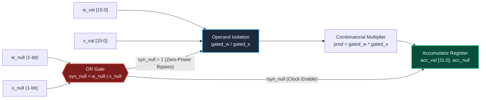

<div align="center">

# Causal Transparency Algebra ($\mathbb{R}_\emptyset$) & $\emptyset$-Net Framework

**Non-Distributive Bi-Identity Algebra, Vectorized Dual-Tensor PyTorch Engine & Zero-Power Verilog RTL Neuromorphic Architecture**

[](https://doi.org/10.5281/zenodo.24175268)
[](https://github.com/GuettHM/rnull-framework/releases/tag/v1.0.1)
[](https://pytorch.org/)
[](./hardware/rnull_mac.v)
[](./tests/test_patterns.py)
[](./LICENSE)

[**📄 Technical Monograph (PDF)**](./paper/) · [**💻 PyTorch Core (`rnull/`)**](./rnull/) · [**⚡ Verilog RTL (`hardware/`)**](./hardware/) · [**🧪 Interactive Dashboard**](./dashboard/index.html) · [**📊 1M-Synapse Benchmarks**](./benchmarks/)

</div>

---

> [!IMPORTANT]
> **Executive Summary — The Fundamental Flaw of Standard Arithmetic:**
>
> Conventional computing systems (IEEE-754 floating-point and classical real algebra $\mathbb{R}$) conflate two fundamentally distinct epistemic states into a single symbol (`0.0`): **measured zero magnitude** ($0 \in \mathbb{R}$) and **complete absence of causal signal** ($\emptyset \notin \mathbb{R}$).
> * Imputing missing signals with `0.0` causes **multiplicative zero-collapse** ($x \cdot 0 = 0$) in gated neural layers and **bias-driven hallucinations** under total sensor blackout.
> * Encoding missing signals as IEEE-754 `NaN` triggers **catastrophic absorbing failure** ($x + \text{NaN} = \text{NaN}$), destroying entire reduction trees.
>
> **The** $\mathbb{R}_\emptyset$ **&** $\emptyset$-Net **Solution:** We extend the real numbers to $\mathbb{R}_\emptyset = \mathbb{R} \cup \lbrace \emptyset \rbrace$, establishing a **non-distributive bi-identity algebraic structure** where $\emptyset$ acts as a universal bilateral identity ($x \oplus \emptyset = x$ and $x \otimes \emptyset = x$) paired with causally directed synaptic operators ($\rhd, \odot$). The framework spans formal abstract algebra, a **SIMD/CUDA Dual-Tensor PyTorch engine**, and a **synthesizable Verilog RTL Multiply-Accumulate (MAC) unit** with physical zero-power clock/operand gating.

---

### 📊 Key Engineering Breakthroughs at a Glance

| Core Engineering Challenge | Standard Deep Learning ($\mathbb{R}$ / IEEE-754) | $\mathbb{R}_\emptyset$ & $\emptyset$-Net Framework (`v1.0.1`) | Verified Empirical Metric |
| :--- | :--- | :--- | :--- |
| **Catastrophic Forgetting** | Weight Decay ($-\lambda W$) and momentum erode frozen weights even when $\nabla W = 0$. | Protected weights receive $\Delta W = \emptyset \implies W^{(t+1)} = W^{(t)} \oplus \emptyset = W^{(t)}$. | **`MSE = 0.0000000000`** (Exact zero drift) |
| **Multimodal Sensor Dropout** | Offline LiDAR (`0.0`) zeroes out multiplicative fusion ($S_{\text{cam}} \cdot 0 \cdot S_{\text{radar}} = 0$). | Bi-identity fusion $S_{\text{cam}} \otimes \emptyset \otimes S_{\text{radar}} = S_{\text{cam}} \otimes S_{\text{radar}}$. | **100% Signal Preservation** (Zero fallback branching) |
| **OOD Bias Hallucination** | Total input loss ($X = 0$) still fires arbitrary logits via static bias vectors ($b$). | Absorbing synaptic MAC ($\odot$) + transparent $\oplus$-accumulation suppresses bias. | **Deterministic** $Y = \emptyset$ (Native epistemic refusal) |
| **Dynamic MAC Power Waste** | Combinatorial multipliers switch on masked or pruned synapses. | 1-Bit causal tag (`w_null \| x_null`) physically gates RTL multiplier & adder trees. | **Zero-Power** $\emptyset$-Bypass ($Acc_t = Acc_{t-1}$) |

---

## 1. Visual System Architecture & Co-Design Stack

The $\emptyset$-Net architecture bridges abstract non-distributive algebra with commodity GPU execution and custom ASIC/FPGA hardware synthesis across three bit-exact layers:

```mermaid
flowchart LR
    subgraph ALG["1. Formal Algebraic Core (ℝ_∅ = ℝ ∪ {∅})"]
        direction TB
        A1["⊕ Additive Bi-Identity<br/>x ⊕ ∅ = x  (AND Mask)"]
        A2["⊗ Multiplicative Bi-Identity<br/>x ⊗ ∅ = x  (AND Mask)"]
        A3["χ_∅(x) ∈ {0, 1}<br/>Non-Distributivity Detector"]
        A4["▷ / ⊙ Synaptic Coupling<br/>Skip-Wire & MAC Gating"]
    end

    subgraph SW["2. Vectorized PyTorch Emulator (rnull/)"]
        direction TB
        S1["RNullTensor(v: fp32, m: bool)<br/>SIMD/CUDA torch.where"]
        S2["Drift-Free Continual Learning<br/>W(t+1) = W(t) ⊕ ∅  (MSE = 0.0)"]
        S3["RNullLinear Layer<br/>OOD Epistemic Abstention (Y = ∅)"]
    end

    subgraph HW["3. Neuromorphic Verilog RTL (hardware/)"]
        direction TB
        H1["1-Bit Causal Tagging<br/>(w_null, x_null)"]
        H2["syn_null = w_null | x_null<br/>Combinatorial Operand Isolation"]
        H3["Zero-Power Clock Gating<br/>Acc(t) <= Acc(t-1)"]
    end

    ALG ==> SW
    ALG ==> HW
    SW -. "Bit-Exact Equivalence" .-> HW

    style ALG fill:#0f172a,stroke:#38bdf8,stroke-width:2px,color:#f8fafc
    style SW fill:#1e1b4b,stroke:#818cf8,stroke-width:2px,color:#f8fafc
    style HW fill:#064e3b,stroke:#34d399,stroke-width:2px,color:#f8fafc
```



### ⚡ 30-Second Quick-Start

```python
import torch
from rnull.core import RNullTensor, RNullLinear, continual_learning_step

# 1. Fault-Tolerant Multimodal Fusion: LiDAR drops offline (is_null=True) without zeroing Camera & Radar
s_cam   = RNullTensor([2.0, 4.0], is_null=[False, False])
s_lidar = RNullTensor([0.0, 0.0], is_null=[True,  True])   # Sensor offline -> ∅
s_radar = RNullTensor([3.0, 5.0], is_null=[False, False])
fused   = s_cam * s_lidar * s_radar                        # RNullTensor(v=[6.0, 20.0], is_null=[False, False])

# 2. Drift-Free Continual Learning: Protected weights ignore Weight Decay & Momentum (MSE = 0.0)
weights     = torch.nn.Parameter(torch.tensor([1.50, -2.00, 0.80]))
frozen_mask = torch.tensor([True, True, False])            # Freeze first two parameters (ΔW = ∅)
continual_learning_step(weights, raw_delta=torch.tensor([-0.05, 0.12, 0.30]), frozen_mask=frozen_mask)

# 3. Native OOD Epistemic Abstention: All-null input yields Y = ∅ (no static bias hallucination)
layer  = RNullLinear(in_features=4, out_features=2, bias=True)
output = layer(RNullTensor.null_like(torch.zeros(1, 4)))   # output.m == True (Explicit Refusal Y = ∅)
```

---

## 2. Mathematical Formulation ($\mathbb{R}_\emptyset$)

Let $\mathbb{R}_\emptyset = \mathbb{R} \cup \lbrace \emptyset \rbrace$ be the extended set of real numbers equipped with the formal epistemic abstention element $\emptyset \notin \mathbb{R}$.

### 2.1 Axiomatic Foundation & Universal Bi-Identity ($\oplus, \otimes$)

Unlike classical ring theory where additive ($0$) and multiplicative ($1$) identities remain strictly separate, $\emptyset$ serves as a **Universal Bilateral Identity** across both extended addition ($\oplus$) and extended multiplicative fusion ($\otimes$):

* **Axiom 1 (Bilateral Neutrality — Logical `AND` on masks `self.m & other.m`):**

$$\forall x \in \mathbb{R}_\emptyset: \quad x \oplus \emptyset = \emptyset \oplus x = x \quad \land \quad x \otimes \emptyset = \emptyset \otimes x = x$$

* **Axiom 2 (Quotient Collapse & Subtractive Neutrality):**

$$\forall x \in \mathbb{R}_\emptyset: \quad x \ominus \emptyset = x, \quad \emptyset \ominus x = -x, \quad x \oslash \emptyset = \emptyset \oslash x = \emptyset$$

This bi-identity structure allows multiplicative sensor fusion layers ($S_{\text{cam}} \otimes S_{\text{lidar}} \otimes S_{\text{radar}}$) to bypass an offline sensor ($S_{\text{lidar}} = \emptyset$) transparently ($S_{\text{cam}} \otimes \emptyset \otimes S_{\text{radar}} = S_{\text{cam}} \otimes S_{\text{radar}}$), while additive accumulations ignore missing pathways ($x_1 \oplus \emptyset \oplus x_3 = x_1 \oplus x_3$).

### 2.2 The Causal Clock & Algebraic State Detector $\chi_\emptyset(x)$

In $\mathbb{R}_\emptyset$, the controlled interaction between $0$ and $\emptyset$ breaks classical distributivity deliberately:

$$a \otimes (0 \oplus \emptyset) = a \otimes 0 = 0 \quad \neq \quad (a \otimes 0) \oplus (a \otimes \emptyset) = 0 \oplus a = a \qquad (\forall a \in \mathbb{R} \setminus \lbrace 0 \rbrace)$$

Setting $a = 1$ yields the **Causal Defect Functional** $\chi_\emptyset: \mathbb{R}_\emptyset \to \lbrace 0, 1 \rbrace$ using solely the basic operators $(\oplus, \ominus, \otimes)$:

$$\chi_\emptyset(x) \triangleq \big((1 \otimes 0) \oplus (1 \otimes x)\big) \ominus \big(1 \otimes (0 \oplus x)\big) = \begin{cases} (0 + x) - (1 \cdot x) = 0 & \forall x \in \mathbb{R} \text{ (including } x = 0\text{)} \\ (0 \oplus 1) \ominus (1 \otimes 0) = 1 - 0 = 1 & \text{if } x = \emptyset \end{cases}$$

<details>
<summary><b>Click to expand step-by-step algebraic proof of $\chi_\emptyset(x) \in \lbrace 0, 1 \rbrace$</b></summary>

1. **Case 1 — Active non-zero real signal ($x \in \mathbb{R} \setminus \lbrace 0 \rbrace$):**
   * Left term: $(1 \otimes 0) \oplus (1 \otimes x) = 0 \oplus x = x$
   * Right term: $1 \otimes (0 \oplus x) = 1 \otimes x = x$
   * Result: $\chi_\emptyset(x) = x \ominus x = 0$.

2. **Case 2 — Measured numerical zero ($x = 0 \in \mathbb{R}$):**
   * Left term: $(1 \otimes 0) \oplus (1 \otimes 0) = 0 \oplus 0 = 0$
   * Right term: $1 \otimes (0 \oplus 0) = 1 \otimes 0 = 0$
   * Result: $\chi_\emptyset(0) = 0 \ominus 0 = 0$ (strictly distinguished from $\emptyset$).

3. **Case 3 — Epistemic abstention ($x = \emptyset$):**
   * Left term: $(1 \otimes 0) \oplus (1 \otimes \emptyset) = 0 \oplus 1 = 1$ (by bilateral multiplicative identity $1 \otimes \emptyset = 1$).
   * Right term: $1 \otimes (0 \oplus \emptyset) = 1 \otimes 0 = 0$ (by bilateral additive identity $0 \oplus \emptyset = 0$).
   * Result: $\chi_\emptyset(\emptyset) = 1 \ominus 0 = 1$.

</details>

### 2.3 Synaptic Propagation Operators ($\rhd$ and $\odot$) & Hardware Bypass

In neural layers and hardware Multiply-Accumulate (MAC) units, interactions between weight $W_{ij}$ and input $x_j$ follow two dedicated synaptic operators:

* **Directed Synaptic Skip Coupling ($\rhd$ — Native Skip-Wire vs. Input Abstention):**

$$W_{ij} \rhd x_j \triangleq \begin{cases} W_{ij} \otimes x_j & \text{if } \chi_\emptyset(x_j) = 0 \;\; (x_j \in \mathbb{R}) \\ \emptyset & \text{if } \chi_\emptyset(x_j) = 1 \;\; (x_j = \emptyset) \end{cases}$$

  1. **Native Skip-Connection ($W_{ij} = \emptyset, \, x_j \in \mathbb{R}$):** $W_{ij} \rhd x_j = \emptyset \otimes x_j = x_j$ (passive wire passthrough at zero FLOPs).
  2. **Native Epistemic Abstention ($x_j = \emptyset$):** $W_{ij} \rhd \emptyset = \emptyset$ (synapse abstains).

* **Absorbing Synaptic MAC Coupling ($\odot$ — Logical `OR` on masks `w.m | x.m`):**

$$W_{ij} \odot x_j = \begin{cases} W_{ij} \cdot x_j & \text{if } W_{ij}, x_j \in \mathbb{R} \\ \emptyset & \text{if } W_{ij} = \emptyset \text{ or } x_j = \emptyset \end{cases} \qquad \Longrightarrow \qquad y_i = \bigoplus_{j=1}^{N} \left( W_{ij} \odot x_j \right)$$

### 2.4 Operational Cayley Tables

| $\oplus$ (Additive Bi-Identity) | $b \in \mathbb{R} \setminus \lbrace 0 \rbrace$ | $0$ | $\emptyset$ |
| :--- | :---: | :---: | :---: |
| **$a \in \mathbb{R} \setminus \lbrace 0 \rbrace$** | $a + b$ | $a$ | $a$ |
| **$0$** | $b$ | $0$ | $0$ |
| **$\emptyset$** | $b$ | $0$ | $\emptyset$ |

| $\otimes$ (Multiplicative Bi-Identity) | $b \in \mathbb{R} \setminus \lbrace 0, 1 \rbrace$ | $1$ | $0$ | $\emptyset$ |
| :--- | :---: | :---: | :---: | :---: |
| **$a \in \mathbb{R} \setminus \lbrace 0, 1 \rbrace$** | $a \cdot b$ | $a$ | $0$ | $a$ |
| **$1$** | $b$ | $1$ | $0$ | $1$ |
| **$0$** | $0$ | $0$ | $0$ | $0$ |
| **$\emptyset$** | $b$ | $1$ | $0$ | $\emptyset$ |

| $W \rhd x$ (Directed Synaptic Skip) | Input $x \in \mathbb{R} \setminus \lbrace 0 \rbrace$ | Input $x = 0$ | Input $x = \emptyset$ |
| :--- | :---: | :---: | :---: |
| **Weight $W \in \mathbb{R} \setminus \lbrace 0 \rbrace$** | $W \cdot x$ | $0$ | $\emptyset$ |
| **Weight $W = 0$** | $0$ | $0$ | $\emptyset$ |
| **Weight $W = \emptyset$ (Skip-Wire)** | $x$ | $0$ | $\emptyset$ |

| $W \odot x$ (Absorbing MAC Synapse) | Input $x \in \mathbb{R} \setminus \lbrace 0 \rbrace$ | Input $x = 0$ | Input $x = \emptyset$ |
| :--- | :---: | :---: | :---: |
| **Weight $W \in \mathbb{R} \setminus \lbrace 0 \rbrace$** | $W \cdot x$ | $0$ | $\emptyset$ |
| **Weight $W = 0$** | $0$ | $0$ | $\emptyset$ |
| **Weight $W = \emptyset$ (Pruned)** | $\emptyset$ | $\emptyset$ | $\emptyset$ |

---

## 3. Structural Comparison Matrix

| Technical Property | Classical Real Arithmetic ($\mathbb{R}$) | IEEE-754 `NaN` / SQL `NULL` | Causal Transparency ($\mathbb{R}_\emptyset$) |
| :--- | :--- | :--- | :--- |
| **Identity Topology** | $0$ for addition, $1$ for multiplication | Destructive absorbing element | Universal Bi-Identity ($x \oplus \emptyset = x, \, x \otimes \emptyset = x$) |
| **Multiplicative Gating** | $x \cdot 0 = 0$ (Destroys active signal) | $x \cdot \text{NaN} = \text{NaN}$ (Graph crash) | $x \otimes \emptyset = x$ (Transparent passthrough) |
| **Synaptic Coupling** | $W \cdot 0 = 0$ (Conflates zero & absence) | `NaN` corrupts entire layer | $\emptyset \rhd x = x$ (Skip) / $W \odot \emptyset = \emptyset$ (MAC Gate) |
| **State Detection** | Requires comparator / branch | Requires bitwise `isnan` checks | Algebraic polynomial $\chi_\emptyset(x) \in \lbrace 0, 1 \rbrace$ |
| **Hardware Execution** | Dense FP32 MAC switching | Not supported for gating | RTL 1-bit `is_null` clock/operand bypass |
| **Continual Weight Update** | Eroded by Weight Decay & Momentum | Corrupts parameter tensors | Exact Parameter Freezing ($W \oplus \emptyset = W$) |
| **Total Input Absence** ($X = \emptyset$) | Hallucinates via static bias vectors | Propagates numerical errors | Native Epistemic Abstention ($Y = \emptyset$) |

---

## 4. PyTorch Dual-Tensor API Reference (`rnull/core.py`)

Because commodity CPUs and GPUs execute dense IEEE-754 pipelines without physical high-impedance (`Hi-Z`) lines, `RNullTensor` pairs a dense payload tensor `self.v` (`torch.float32`) with an explicit causal abstention mask `self.m` (`torch.bool`).

| API Method / Module | Algebraic Operator | Mask Logic (`torch.bool`) | Engineering Purpose |
| :--- | :---: | :---: | :--- |
| `a + b` (`__add__`) | $a \oplus b$ | `a.m & b.m` (`AND`) | Causal-transparent accumulation & zero-drift parameter updates. |
| `a - b` (`__sub__`) | $a \ominus b$ | `a.m & b.m` (`AND`) | Extended subtraction ($x \ominus \emptyset = x, \, \emptyset \ominus x = -x$). |
| `a * b` (`__mul__`) | $a \otimes b$ | `a.m & b.m` (`AND`) | Fault-tolerant multiplicative sensor fusion ($S_{\text{cam}} \otimes \emptyset \otimes S_{\text{radar}}$). |
| `w.synaptic_mul(x)` | $W \odot x$ | `w.m \| x.m` (`OR`) | Absorbing synaptic MAC coupling matching Verilog RTL hardware gating. |
| `w.synaptic_skip(x)` | $W \rhd x$ | `x.m` (Directed) | Passive skip-wire when $W = \emptyset$ and abstention when $x = \emptyset$. |
| `x.chi_null(evaluate_polynomial=True)` | $\chi_\emptyset(x)$ | `x.m.to(torch.float32)` | Evaluates $((1 \otimes 0) \oplus (1 \otimes x)) \ominus (1 \otimes (0 \oplus x)) \in \lbrace 0, 1 \rbrace$. |
| `RNullLinear(in_f, out_f)` | $\bigoplus_j (W_{ij} \odot x_j)$ | `syn_m.all(dim=-1)` | Neural linear layer with native OOD abstention ($Y = \emptyset$) & zero bias leak. |
| `continual_learning_step(...)` | $W^{(t)} \oplus \Delta W$ | `frozen_mask` $\mapsto \emptyset$ | Exact weight freezing ($\text{MSE} = 0.0$) immune to AdamW weight decay. |

---

## 5. Hardware Integration: Verilog RTL Neuromorphic MAC (`hardware/`)

The `/hardware/rnull_mac.v` module translates $\mathbb{R}_\emptyset$ into synthesizable Register-Transfer Level (RTL) hardware, achieving physical dynamic power savings on sparse or abstaining workloads:



### Hardware Pinout & Gating Behavior (`rnull_mac`)

| Signal Port | Direction | Width | Algebraic Semantics & Hardware Behavior |
| :--- | :---: | :---: | :--- |
| `clk`, `rst_n`, `clear_acc` | `input` | `1-bit` | Synchronous clock, active-low reset, and epoch accumulator clear (`acc_null <= 1'b1`). |
| `w_val`, `w_null` | `input` | `16b` + `1b` | Synaptic weight payload and 1-bit causal tag (`w_null == 1'b1` $\iff W_{ij} = \emptyset$). |
| `x_val`, `x_null` | `input` | `16b` + `1b` | Input activation payload and 1-bit causal tag (`x_null == 1'b1` $\iff x_j = \emptyset$). |
| `acc_val`, `acc_null` | `output reg` | `32b` + `1b` | Registered accumulator state ($Acc_t = Acc_{t-1} \oplus (W_{ij} \odot x_j)$). When `syn_null == 1'b1`, operand isolation clamps multiplier inputs to `0` and register clock-enable holds state unchanged. |

---

## 6. Installation, Tests & 1M-Synapse Benchmarks

### 6.1 Local Installation & Verification

```bash
git clone [https://github.com/GuettHM/rnull-framework.git](https://github.com/GuettHM/rnull-framework.git)
cd rnull-framework
pip install -e ".[dev]"

# Run the automated pytest verification suite (bi-identity, chi_null, OOD, continual learning)
pytest tests/ -v

# Execute the 1,000,000-synapse (1000x1000) matrix & zero-drift continual learning benchmark
python benchmarks/run_benchmarks.py
```

### 6.2 Reference Benchmark Summary ($1000 \times 1000$ Synaptic Matrix)

| Benchmark Workload | Configuration | Measured Result |
| :--- | :--- | :--- |
| **1M-Synapse RTL Bypass Rate** | $1000 \times 1000$ matrix, $70\%$ causal abstention rate (`is_null=True`) | **`910,000 / 1,000,000` MACs physically gated (`91.00%`)** |
| **Continual Learning Drift** | $800,000$ frozen synapses across $100$ optimizer steps with Weight Decay ($-\lambda W$) | **`MSE = 0.000000000000` (Exact Zero Drift)** |
| **Interactive Browser Suite** | Open `dashboard/index.html` locally in any modern browser | **Zero-dependency client-side verification lab** |

---

## 7. Repository Structure

```text
rnull-framework/
├── rnull/                  # Vectorized Dual-Tensor (v, m) PyTorch emulator of ℝ_∅ and ∅-Net
│   ├── __init__.py
│   └── core.py
├── tests/                  # Automated pytest suite validating axioms & the 4 AI/RTL patterns
│   └── test_patterns.py
├── benchmarks/             # 1M-synapse (1000x1000) matrix & continual learning benchmark suite
│   └── run_benchmarks.py
├── hardware/               # Synthesizable Verilog RTL MAC module with Zero-Power ∅-Bypass
│   └── rnull_mac.v
├── dashboard/              # Interactive local web dashboard for testing ℝ_∅ & RTL gating
│   └── index.html
├── paper/                  # Technical Monograph PDF, Cayley tables, and TikZ circuit diagrams
│   └── Causal Transparency Algebra & ∅-Net - Complete Technical Guide.pdf
├── CITATION.cff            # Official citation metadata (synchronized with Zenodo v1.0.1)
├── pyproject.toml          # Python package configuration and dependencies
├── LICENSE                 # MIT License
└── README.md               # Project documentation
```

---

## 8. How to Cite

If you use the **Causal Transparency Algebra ($\mathbb{R}_\emptyset$)** or the **$\emptyset$-Net Framework** in your research, please cite the official CERN/Zenodo archive:

```bibtex
@software{guettal_2026_rnull,
  author       = {Guettal, Hakim},
  title        = {Causal Transparency Algebra (ℝ_∅) & ∅-Net Framework},
  month        = nov,
  year         = 2026,
  publisher    = {Zenodo},
  version      = {v1.0.1},
  doi          = {10.5281/zenodo.24175268},
  url          = {[https://doi.org/10.5281/zenodo.24175268](https://doi.org/10.5281/zenodo.24175268)}
}
```

---

## 9. License

This project is licensed under the **MIT License** — see the [LICENSE](./LICENSE) file for details.
