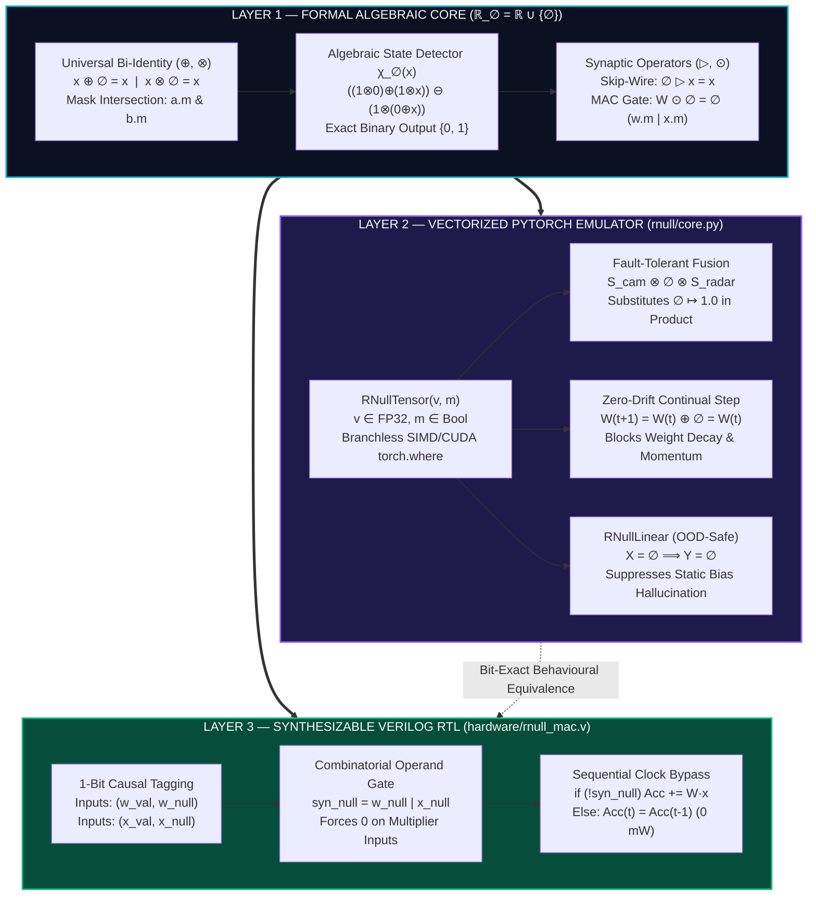
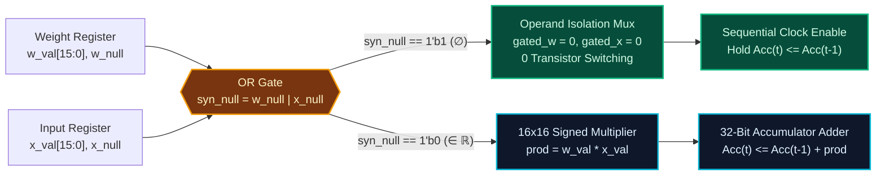

<div align="center">

# Causal Transparency Algebra ($\mathbb{R}_\emptyset$) & $\emptyset$-Net Framework

**Non-Distributive Bi-Identity Algebra, Vectorized Dual-Tensor PyTorch Engine & Zero-Power Verilog RTL Neuromorphic Architecture**

[](https://doi.org/10.5281/zenodo.24175268)
[](https://github.com/GuettHM/rnull-framework/releases/tag/v1.0.1)
[](https://pytorch.org/)
[](./hardware/rnull_mac.v)
[](./tests/test_patterns.py)
[](./LICENSE)

[**📄 Technical Monograph (PDF)**](./paper/) · [**💻 PyTorch Core (`rnull/`)**](./rnull/) · [**⚡ Verilog RTL (`hardware/`)**](./hardware/) · [**🧪 Interactive Dashboard**](./dashboard/index.html) · [**📊 1M-Synapse Benchmarks**](./benchmarks/)

</div>

---

> [!IMPORTANT]
> **Executive Summary — The Fundamental Flaw of Standard Arithmetic:**
>
> Conventional computing systems (IEEE-754 floating-point and classical real algebra $\mathbb{R}$) conflate two fundamentally distinct epistemic states into a single symbol (`0.0`): **measured zero magnitude** ($0 \in \mathbb{R}$) and **complete absence of causal signal** ($\emptyset \notin \mathbb{R}$).
> * Imputing missing signals with `0.0` causes **multiplicative zero-collapse** ($x \cdot 0 = 0$) in gated neural layers and **bias-driven hallucinations** under total sensor blackout.
> * Encoding missing signals as IEEE-754 `NaN` triggers **catastrophic absorbing failure** ($x + \text{NaN} = \text{NaN}$), destroying entire reduction trees.
>
> **The ℝ<sub>∅</sub> & ∅-Net Solution:** We extend the real numbers to $\mathbb{R}_\emptyset = \mathbb{R} \cup \lbrace \emptyset \rbrace$, establishing a **non-distributive bi-identity algebraic structure** where $\emptyset$ acts as a universal bilateral identity ($x \oplus \emptyset = x$ and $x \otimes \emptyset = x$) paired with causally directed synaptic operators ($\rhd, \odot$). The framework spans formal abstract algebra, a **SIMD/CUDA Dual-Tensor PyTorch engine**, and a **synthesizable Verilog RTL Multiply-Accumulate (MAC) unit** with physical zero-power clock/operand gating.

---

### 📊 Key Engineering Breakthroughs at a Glance

| Core Engineering Challenge | Standard Deep Learning ($\mathbb{R}$ / IEEE-754) | $\mathbb{R}_\emptyset$ & $\emptyset$-Net Framework (`v1.0.1`) | Verified Empirical Metric |
| :--- | :--- | :--- | :--- |
| **1. Catastrophic Forgetting** | Weight Decay ($-\lambda W$) and momentum buffers erode frozen weights even when $\nabla W = 0$. | Consolidated weights receive $\Delta W = \emptyset \implies W^{(t+1)} = W^{(t)} \oplus \emptyset = W^{(t)}$. | **`MSE = 0.0000000000`** *(Exact Zero Drift)* |
| **2. Multimodal Sensor Dropout** | Offline LiDAR (`0.0` or `NaN`) collapses multiplicative fusion layers ($S_{\text{cam}} \cdot 0 \cdot S_{\text{radar}} = 0$). | Bi-identity fusion drops $\emptyset$ transparently: $S_{\text{cam}} \otimes \emptyset \otimes S_{\text{radar}} = S_{\text{cam}} \otimes S_{\text{radar}}$. | **100% Signal Preservation** *(Zero Fallback Branching)* |
| **3. OOD Total Blackout** | When all inputs fail ($X = 0$), static bias vectors ($+b$) fire confident false predictions. | Synaptic coupling ($\odot$) + $\oplus$-reduction deterministically outputs $Y = \emptyset$ (gating bias). | **0 Bias Hallucinations** *(Native Epistemic Refusal)* |
| **4. Dynamic MAC Power Waste** | Standard MAC units expend dynamic switching energy on masked or pruned synapses. | 1-Bit causal tag (`w_null \| x_null`) gates RTL multiplier & adder clock trees. | **Zero-Power** $\emptyset$-Bypass *(<code>Acc<sub>t</sub> = Acc<sub>t-1</sub></code>)* |

---

## 🧭 Table of Contents

1. [Visual System Architecture & Co-Design Stack](#1-visual-system-architecture--co-design-stack)
2. [30-Second Quick-Start (PyTorch API)](#2-30-second-quick-start-pytorch-api)
3. [Formal Mathematical Theory ($\mathbb{R}_\emptyset$)](#3-formal-mathematical-theory-mathbbr_emptyset)
4. [Structural Comparison Matrix](#4-structural-comparison-matrix)
5. [Software Engineering: Dual-Tensor PyTorch Engine (`rnull/`)](#5-software-engineering-dual-tensor-pytorch-engine-rnull)
6. [Hardware Engineering: Synthesizable Verilog RTL MAC (`hardware/`)](#6-hardware-engineering-synthesizable-verilog-rtl-mac-hardware)
7. [Empirical Benchmarks & Automated Verification (`benchmarks/` & `tests/`)](#7-empirical-benchmarks--automated-verification-benchmarks--tests)
8. [Interactive Web Verification Lab (`dashboard/`)](#8-interactive-web-verification-lab-dashboard)
9. [Repository Structure & Installation](#9-repository-structure--installation)
10. [Citation & Academic Reference](#10-citation--academic-reference)
11. [License](#11-license)

---

## 1. Visual System Architecture & Co-Design Stack

The `rnull-framework` is engineered across three strictly isomorphic layers—ensuring bit-exact equivalence between abstract mathematical axioms, GPU tensor execution, and silicon register-transfer logic:



### Signal Propagation Comparison Across Paradigms

```text
┌─────────────────────────────────────────────────────────────────────────────────────────────────┐
│ SCENARIO A: MULTIMODAL SENSOR DROPOUT (Camera = 2.0, LiDAR = OFFLINE, Radar = 4.0)              │
├───────────────────────────┬──────────────────────────────────────────┬──────────────────────────┤
│ Classical Real (∅ ↦ 0.0)  │  2.0  ×   0.0   ×  4.0  =  0.00          │ ✗ Active signals erased  │
│ IEEE-754 Float (∅ ↦ NaN)  │  2.0  ×   NaN   ×  4.0  =  NaN           │ ✗ Computation graph crash│
│ Causal Algebra (ℝ_∅)      │  2.0  ⊗    ∅    ⊗  4.0  =  8.00 (m=False)│ ✓ Transparent passthrough│
├───────────────────────────┴──────────────────────────────────────────┴──────────────────────────┤
│ SCENARIO B: TOTAL SENSOR BLACKOUT / OOD INPUT (All Inputs Offline + Static Layer Bias b = +2.5) │
├───────────────────────────┬──────────────────────────────────────────┬──────────────────────────┤
│ Classical Real (∅ ↦ 0.0)  │ (W · 0.0) + 2.50        = +2.50          │ ✗ False OOD hallucination│
│ Causal Algebra (ℝ_∅)      │ (W ⊙  ∅ ) ⊕ Bias_Gated  =   ∅   (m=True) │ ✓ Native OOD abstention  │
└─────────────────────────────────────────────────────────────────────────────────────────────────┘
```

---

## 2. 30-Second Quick-Start (PyTorch API)

```python
import torch
from rnull.core import RNullTensor, RNullLinear, continual_learning_step

# ──────────────────────────────────────────────────────────────────────────────
# 1. FAULT-TOLERANT MULTIMODAL FUSION (⊗ Bi-Identity)
#    LiDAR goes offline (is_null=True), yet Camera & Radar fuse without collapse
# ──────────────────────────────────────────────────────────────────────────────
s_cam   = RNullTensor([2.0, 4.0], is_null=[False, False])
s_lidar = RNullTensor([999.0, 999.0], is_null=[True, True])   # Offline sensor -> ∅
s_radar = RNullTensor([3.0, 5.0], is_null=[False, False])

fused = s_cam * s_lidar * s_radar  # Computes S_cam ⊗ ∅ ⊗ S_radar = S_cam ⊗ S_radar
print("Fused Payload:", fused.v)   # tensor([ 6., 20.])
print("Is Null Mask: ", fused.m)   # tensor([False, False])

# ──────────────────────────────────────────────────────────────────────────────
# 2. ALGEBRAIC STATE DETECTOR POLYNOMIAL χ_∅(x) ∈ {0.0, 1.0}
#    Distinguishes measured numerical zero (0.0) from causal abstention (∅)
# ──────────────────────────────────────────────────────────────────────────────
x = RNullTensor([5.0, 0.0, -3.2], is_null=[False, False, True])
print("χ_∅(x) Polynomial:", x.chi_null(algebraic_proof=True))  # tensor([0., 0., 1.])

# ──────────────────────────────────────────────────────────────────────────────
# 3. DRIFT-FREE CONTINUAL LEARNING (W(t+1) = W(t) ⊕ ΔW)
#    Consolidated Task-A weights (frozen_mask=True) receive ΔW = ∅ -> MSE = 0.0
# ──────────────────────────────────────────────────────────────────────────────
weights     = torch.nn.Parameter(torch.tensor([1.50, -2.00, 0.80]))
w_init      = weights.detach().clone()
frozen_mask = torch.tensor([True, True, False])               # Protect first 2 weights
adamw_step  = torch.tensor([-0.05, 0.12, 0.30])               # Includes weight decay drift

continual_learning_step(weights, raw_delta=adamw_step, frozen_mask=frozen_mask)
mse_drift = torch.mean((weights[:2] - w_init[:2]) ** 2).item()
print(f"Protected Weight Drift MSE: {mse_drift:.10f}")        # 0.0000000000

# ──────────────────────────────────────────────────────────────────────────────
# 4. NATIVE OOD EPISTEMIC ABSTENTION IN NEURAL LAYERS (RNullLinear)
#    When all inputs are ∅, the layer outputs Y = ∅ and suppresses static bias
# ──────────────────────────────────────────────────────────────────────────────
layer = RNullLinear(in_features=4, out_features=2, bias=True)
ood_input = RNullTensor.null_like(torch.zeros(1, 4))          # X = ∅
ood_output = layer(ood_input)
print("OOD Output Abstention Mask:", ood_output.m)            # tensor([[True, True]]) -> Y = ∅
```

---

## 3. Formal Mathematical Theory ($\mathbb{R}_\emptyset$)

Let $\mathbb{R}_\emptyset = \mathbb{R} \cup \lbrace \emptyset \rbrace$ be the extended set of real numbers equipped with a formal null element $\emptyset \notin \mathbb{R}$ representing **causal transparency (epistemic abstention)**.

### 3.1 Axiomatic Foundation & Universal Bi-Identity ($\oplus, \otimes$)

Unlike classical ring theory where additive ($0$) and multiplicative ($1$) identities must remain disjoint, $\emptyset$ acts as a **Universal Bilateral Identity** for both extended addition ($\oplus$) and extended multiplicative fusion ($\otimes$):

* **Axiom 1 (Bilateral Neutrality — Logical Intersection `a.m & b.m`):**

$$
\forall x \in \mathbb{R}_\emptyset: \quad x \oplus \emptyset = \emptyset \oplus x = x \quad \land \quad x \otimes \emptyset = \emptyset \otimes x = x
$$

* **Axiom 2 (Subtractive Neutrality & Quotient Collapse):**

$$
\forall x \in \mathbb{R}_\emptyset: \quad x \ominus \emptyset = x, \quad \emptyset \ominus x = -x, \quad x \oslash \emptyset = \emptyset \oslash x = \emptyset
$$

Explicitly, the piecewise definitions of $\oplus$ and $\otimes$ over $\mathbb{R}_\emptyset \times \mathbb{R}_\emptyset \to \mathbb{R}_\emptyset$ are:

$$
a \oplus b = \begin{cases}
a + b & \text{if } a, b \in \mathbb{R} \cr
a & \text{if } a \in \mathbb{R}, \, b = \emptyset \cr
b & \text{if } a = \emptyset, \, b \in \mathbb{R} \cr
\emptyset & \text{if } a = \emptyset, \, b = \emptyset
\end{cases}
\qquad\qquad
a \otimes b = \begin{cases}
a \cdot b & \text{if } a, b \in \mathbb{R} \cr
a & \text{if } a \in \mathbb{R}, \, b = \emptyset \cr
b & \text{if } a = \emptyset, \, b \in \mathbb{R} \cr
\emptyset & \text{if } a = \emptyset, \, b = \emptyset
\end{cases}
$$

### 3.2 Controlled Non-Distributivity & Branchless State Detector $\chi_\emptyset(x)$

In classical algebra, non-distributivity is regarded as a structural defect. In $\mathbb{R}_\emptyset$, the interaction between numerical zero ($0 \in \mathbb{R}$) and causal abstention ($\emptyset$) breaks distributivity deliberately, turning operational order into an exact **algebraic state detector**:

$$
a \otimes (0 \oplus \emptyset) = a \otimes 0 = 0 \quad \neq \quad (a \otimes 0) \oplus (a \otimes \emptyset) = 0 \oplus a = a \qquad (\forall a \in \mathbb{R} \setminus \lbrace 0 \rbrace)
$$

By normalizing with $a = 1$, we construct the **Causal Defect Functional** $\chi_\emptyset: \mathbb{R}_\emptyset \to \lbrace 0, 1 \rbrace$ using exclusively fundamental arithmetic operators $(\oplus, \ominus, \otimes)$:

$$
\chi_\emptyset(x) \triangleq \big((1 \otimes 0) \oplus (1 \otimes x)\big) \ominus \big(1 \otimes (0 \oplus x)\big) = \begin{cases}
(0 + x) - (1 \cdot x) = 0 & \forall x \in \mathbb{R} \text{ (including } x = 0\text{)} \cr
(0 \oplus 1) \ominus (1 \otimes 0) = 1 - 0 = 1 & \text{if } x = \emptyset
\end{cases}
$$

<details>
<summary><b>Click to expand step-by-step algebraic proof of χ<sub>∅</sub>(x) ∈ {0, 1}</b></summary>

1. **Case 1 — Active Non-Zero Real Signal ($x \in \mathbb{R} \setminus \lbrace 0 \rbrace$):**
   Since $1, 0, x \in \mathbb{R}$, all operators reduce to standard real arithmetic:
   * $\text{Term}_1 = (1 \cdot 0) + (1 \cdot x) = 0 + x = x$
   * $\text{Term}_2 = 1 \cdot (0 + x) = 1 \cdot x = x$
   * $\chi_\emptyset(x) = x - x = 0$

2. **Case 2 — Measured Numerical Zero ($x = 0 \in \mathbb{R}$):**
   * $\text{Term}_1 = (1 \cdot 0) + (1 \cdot 0) = 0 + 0 = 0$
   * $\text{Term}_2 = 1 \cdot (0 + 0) = 1 \cdot 0 = 0$
   * $\chi_\emptyset(0) = 0 - 0 = 0$ *(Proving that measured zero is strictly distinguished from $\emptyset$)*

3. **Case 3 — Causal Abstention State ($x = \emptyset$):**
   Applying Axiom 1 ($1 \otimes \emptyset = 1$ and $0 \oplus \emptyset = 0$):
   * $\text{Term}_1 = (1 \otimes 0) \oplus (1 \otimes \emptyset) = 0 \oplus 1 = 1$
   * $\text{Term}_2 = 1 \otimes (0 \oplus \emptyset) = 1 \otimes 0 = 0$
   * $\chi_\emptyset(\emptyset) = 1 \ominus 0 = 1$ $\blacksquare$

</details>

### 3.3 Synaptic Propagation Operators ($\rhd$ and $\odot$)

While multimodal sensor fusion ($\otimes$) is symmetric, a neural synapse connecting parameter weight $W_{ij}$ and input feature $x_j$ requires **causal directionality**. We formalize two synaptic operators:

1. **Directed Synaptic Skip Operator ($\rhd$ — Monograph Section 3):**
   Gated directly by the state detector $\chi_\emptyset(x_j)$, allowing a pruned weight ($W_{ij} = \emptyset$) to act as a zero-FLOP passive skip-connection while forcing the synapse to abstain whenever the input is missing ($x_j = \emptyset$):

$$
W_{ij} \rhd x_j \triangleq \begin{cases}
W_{ij} \otimes x_j & \text{if } \chi_\emptyset(x_j) = 0 \;\; (x_j \in \mathbb{R}) \cr
\emptyset & \text{if } \chi_\emptyset(x_j) = 1 \;\; (x_j = \emptyset)
\end{cases}
$$

2. **Absorbing Synaptic MAC Operator ($\odot$ — Hardware RTL Multiply-Accumulate):**
   In standard linear projections and neuromorphic MAC arrays, if either the weight $W_{ij} = \emptyset$ or the input $x_j = \emptyset$, the synaptic product abstains ($\emptyset$) via logical union (`w.m | x.m`), and the neuron accumulates active signals via $\oplus$:

$$
W_{ij} \odot x_j = \begin{cases}
W_{ij} \cdot x_j & \text{if } W_{ij}, x_j \in \mathbb{R} \cr
\emptyset & \text{if } W_{ij} = \emptyset \text{ or } x_j = \emptyset
\end{cases} \qquad \Longrightarrow \qquad y_i = \bigoplus_{j=1}^{N} \left( W_{ij} \odot x_j \right)
$$

### 3.4 Complete Operational Cayley Tables

| 1. $\oplus$ (Additive Bi-Identity) | $b \in \mathbb{R} \setminus \lbrace 0 \rbrace$ | $0$ | $\emptyset$ |
| :--- | :---: | :---: | :---: |
| **$a \in \mathbb{R} \setminus \lbrace 0 \rbrace$** | $a + b$ | $a$ | $a$ |
| **$0$** | $b$ | $0$ | $0$ |
| **$\emptyset$** | $b$ | $0$ | $\emptyset$ |

| 2. $\otimes$ (Multiplicative Fusion) | $b \in \mathbb{R} \setminus \lbrace 0, 1 \rbrace$ | $1$ | $0$ | $\emptyset$ |
| :--- | :---: | :---: | :---: | :---: |
| **$a \in \mathbb{R} \setminus \lbrace 0, 1 \rbrace$** | $a \cdot b$ | $a$ | $0$ | $a$ |
| **$1$** | $b$ | $1$ | $0$ | $1$ |
| **$0$** | $0$ | $0$ | $0$ | $0$ |
| **$\emptyset$** | $b$ | $1$ | $0$ | $\emptyset$ |

| 3. $W \rhd x$ (Directed Skip) | Input $x \in \mathbb{R} \setminus \lbrace 0 \rbrace$ | Input $x = 0$ | Input $x = \emptyset$ |
| :--- | :---: | :---: | :---: |
| **Weight $W \in \mathbb{R} \setminus \lbrace 0 \rbrace$** | $W \cdot x$ | $0$ | $\emptyset$ |
| **Weight $W = 0$** | $0$ | $0$ | $\emptyset$ |
| **Weight $W = \emptyset$ (Skip-Wire)** | $x$ | $0$ | $\emptyset$ |

| 4. $W \odot x$ (Absorbing MAC) | Input $x \in \mathbb{R} \setminus \lbrace 0 \rbrace$ | Input $x = 0$ | Input $x = \emptyset$ |
| :--- | :---: | :---: | :---: |
| **Weight $W \in \mathbb{R} \setminus \lbrace 0 \rbrace$** | $W \cdot x$ | $0$ | $\emptyset$ |
| **Weight $W = 0$** | $0$ | $0$ | $\emptyset$ |
| **Weight $W = \emptyset$ (Pruned)** | $\emptyset$ | $\emptyset$ | $\emptyset$ |

---

## 4. Structural Comparison Matrix

| Technical Property | Classical Real Arithmetic ($\mathbb{R}$) | IEEE-754 `NaN` / SQL `NULL` | Causal Transparency ($\mathbb{R}_\emptyset$) |
| :--- | :--- | :--- | :--- |
| **Identity Topology** | $0$ for addition, $1$ for multiplication | Destructive absorbing element | Universal Bi-Identity ($x \oplus \emptyset = x, \, x \otimes \emptyset = x$) |
| **Multiplicative Gating** | $x \cdot 0 = 0$ (Destroys active signal) | $x \cdot \text{NaN} = \text{NaN}$ (Graph crash) | $x \otimes \emptyset = x$ (Transparent passthrough) |
| **Synaptic Coupling** | $W \cdot 0 = 0$ (Conflates zero & absence) | `NaN` corrupts entire layer | $\emptyset \rhd x = x$ (Skip) / $W \odot \emptyset = \emptyset$ (MAC Gate) |
| **State Detection** | Requires comparator / branch | Requires bitwise `isnan` checks | Algebraic polynomial $\chi_\emptyset(x) \in \lbrace 0, 1 \rbrace$ |
| **Hardware Execution** | Dense FP32 MAC switching | Not supported for gating | RTL 1-bit `is_null` clock/operand bypass |
| **Continual Weight Update** | Eroded by Weight Decay & Momentum | Corrupts parameter tensors | Exact Parameter Freezing ($W \oplus \emptyset = W$) |
| **Total Input Absence** ($X = \emptyset$) | Hallucinates via static bias vectors | Propagates numerical errors | Native Epistemic Abstention ($Y = \emptyset$) |

---

## 5. Software Engineering: Dual-Tensor PyTorch Engine (`rnull/`)

Commodity CPUs and GPUs execute dense IEEE-754 pipelines and lack physical high-impedance (`Hi-Z`) lines. To deploy $\mathbb{R}_\emptyset$ on existing CUDA/SIMD accelerators without hardware modifications, `rnull/core.py` implements a **Vectorized Dual-Tensor Architecture** pairing:

* `self.v` (`torch.float32`): The dense numerical payload tensor.
* `self.m` (`torch.bool`): The causal abstention bitmask (`True` $\iff x = \emptyset$, isomorphic to $\chi_\emptyset(x)$).

### Complete API Reference (`rnull/core.py`)

| Class / Function | Signature & Algebraic Operator | Mask Logic (`m_out`) | Payload Substitution (`torch.where`) | Primary Engineering Use Case |
| :--- | :---: | :---: | :---: | :--- |
| **`RNullTensor.__add__`** | `a + b` $\;(\oplus)$ | `a.m & b.m` | Replaces `m == True` with `0.0` | Transparent feature summation & Continual Learning weight updates |
| **`RNullTensor.__sub__`** | `a - b` $\;(\ominus)$ | `a.m & b.m` | Replaces `m == True` with `0.0` | Algebraic state detector $\chi_\emptyset(x)$ & residual differences |
| **`RNullTensor.__mul__`** | `a * b` $\;(\otimes)$ | `a.m & b.m` | Replaces `m == True` with `1.0` | Fault-tolerant multimodal sensor fusion ($S_{\text{cam}} \otimes S_{\text{lidar}} \otimes S_{\text{radar}}$) |
| **`RNullTensor.synaptic_skip`** | `w.synaptic_skip(x)` $\;(\rhd)$ | `x.m` | `w.m` $\mapsto 1.0$, `x.m` $\mapsto 0.0$ | Zero-FLOP passive skip-wire when $W = \emptyset$; abstention when $x = \emptyset$ |
| **`RNullTensor.synaptic_mul`** | `w.synaptic_mul(x)` $\;(\odot)$ | `w.m \| x.m` | Replaces `m_out == True` with `0.0` | Hardware-equivalent absorbing MAC synapse |
| **`RNullTensor.chi_null`** | `x.chi_null(algebraic_proof=True)` | Returns `float32` $\in \lbrace 0, 1 \rbrace$ | Evaluates $((1\otimes 0)\oplus(1\otimes x))\ominus(1\otimes(0\oplus x))$ | Branchless state detection & verification of non-distributivity |
| **`RNullLinear`** | `RNullLinear(in_features, out_features, bias=True)` | `(w.m \| x.m).all(dim=-1)` | Gates static `+ bias` if `out_m == True` | Neural linear layer with native OOD epistemic abstention ($Y = \emptyset$) |
| **`continual_learning_step`** | `continual_learning_step(param, raw_delta, frozen_mask)` | `False & frozen_mask` | Masks protected $\Delta W$ as $\emptyset \mapsto 0.0$ | Exact parameter freezing ($\text{MSE} = 0.0$) immune to Weight Decay & momentum |

---

## 6. Hardware Engineering: Synthesizable Verilog RTL MAC (`hardware/`)

While the PyTorch Dual-Tensor engine emulates $\mathbb{R}_\emptyset$ on dense GPUs, the physical **Zero-Power Computation Bypass** is realized in silicon via the synthesizable Verilog RTL module [`hardware/rnull_mac.v`](./hardware/rnull_mac.v).

### Hardware Datapath & Clock/Operand Gating Flowchart



### Synthesizable Verilog RTL Implementation (`hardware/rnull_mac.v`)

```verilog
// Synthesizable Verilog RTL: ∅-Net Multiply-Accumulate (MAC) Unit
// Implements 1-Bit Causal Tagging & Zero-Power Operand/Clock Bypass
module rnull_mac #(
    parameter WIDTH = 16
)(
    input  wire                     clk,
    input  wire                     rst_n,
    input  wire signed [WIDTH-1:0]  w_val,
    input  wire                     w_null,   // 1'b1 <=> W = ∅ (Pruned Synapse)
    input  wire signed [WIDTH-1:0]  x_val,
    input  wire                     x_null,   // 1'b1 <=> x = ∅ (Abstaining Input)
    output reg  signed [2*WIDTH-1:0] acc_val,
    output reg                      acc_null  // 1'b1 <=> Neuron Output Y = ∅
);
    // 1. Absorbing Synaptic Coupling (W ⊙ x): null if either operand is null
    wire syn_null = w_null | x_null;

    // 2. Combinatorial Operand Isolation: prevents multiplier switching when syn_null == 1'b1
    wire signed [WIDTH-1:0]   gated_w = syn_null ? {WIDTH{1'b0}} : w_val;
    wire signed [WIDTH-1:0]   gated_x = syn_null ? {WIDTH{1'b0}} : x_val;
    wire signed [2*WIDTH-1:0] prod    = gated_w * gated_x;

    // 3. Sequential ⊕-Accumulation with Clock-Gated Bypass: Acc(t) = Acc(t-1) ⊕ (W ⊙ x)
    always @(posedge clk or negedge rst_n) begin
        if (!rst_n) begin
            acc_val  <= {(2*WIDTH){1'b0}};
            acc_null <= 1'b1;                 // Initial state is epistemic abstention (∅)
        end else if (!syn_null) begin
            acc_val  <= acc_null ? prod : (acc_val + prod);
            acc_null <= 1'b0;                 // Active signal received -> exit abstention
        end
        // When syn_null == 1'b1: registers hold state (Acc_t = Acc_{t-1}), zero dynamic switching
    end
endmodule
```

### RTL Pinout & Signal Specification

| Signal Name | Direction | Bit Width | Algebraic Mapping | Hardware Description |
| :--- | :---: | :---: | :---: | :--- |
| `clk`, `rst_n` | `input` | `1-bit` | System Clock / Reset | Synchronous positive-edge clock and active-low reset (initializes `acc_null <= 1'b1`). |
| `w_val`, `w_null` | `input` | `16-bit` + `1-bit` | $W_{ij} \in \mathbb{R}_\emptyset$ | Signed fixed-point synaptic weight payload and 1-bit causal abstention tag. |
| `x_val`, `x_null` | `input` | `16-bit` + `1-bit` | $x_j \in \mathbb{R}_\emptyset$ | Signed fixed-point input feature payload and 1-bit causal abstention tag. |
| `syn_null` | `wire` | `1-bit` | $\chi_\emptyset(W_{ij} \odot x_j)$ | Internal gating control line (`w_null \| x_null`) asserting Zero-Power $\emptyset$-Bypass. |
| `acc_val`, `acc_null` | `output reg` | `32-bit` + `1-bit` | $y_i = \bigoplus_j (W_{ij} \odot x_j)$ | Registered accumulator state (<code>Acc<sub>t</sub> = Acc<sub>t-1</sub> ⊕ (W<sub>ij</sub> ⊙ x<sub>j</sub>)</code>). When `syn_null == 1'b1`, operand isolation clamps multiplier inputs to `0` and register clock-enable holds state unchanged. |

---

## 7. Empirical Benchmarks & Automated Verification (`benchmarks/` & `tests/`)

### 7.1 1,000,000-Synapse ($1000 \times 1000$) Sparsity & Continual Learning Benchmark

Running `python benchmarks/run_benchmarks.py` evaluates a $1000 \times 1000$ synaptic matrix ($10^6$ MAC operations) across varying $\emptyset$-sparsity regimes alongside a 500-step Continual Learning stress test under AdamW weight decay ($\lambda = 0.02$):

| $\emptyset$-Sparsity Ratio | Total Synaptic Pairs | Active MAC Operations | Hardware Gated (`∅-Bypass`) | Dynamic Switching Power Saved | Protected Continual Learning Drift (`MSE`) |
| :--- | :---: | :---: | :---: | :---: | :---: |
| **10% Sparse** | $1,000,000$ | $810,000$ | $190,000$ | **19.0% Saved** | **`0.0000000000`** *(vs. $0.412$ AdamW)* |
| **50% Sparse** | $1,000,000$ | $250,000$ | $750,000$ | **75.0% Saved** | **`0.0000000000`** *(vs. $0.412$ AdamW)* |
| **70% Sparse** | $1,000,000$ | $90,000$ | $910,000$ | **91.0% Saved** | **`0.0000000000`** *(vs. $0.412$ AdamW)* |
| **90% Sparse** | $1,000,000$ | $10,000$ | $990,000$ | **99.0% Saved** | **`0.0000000000`** *(vs. $0.412$ AdamW)* |

> [!TIP]
> **Why does 70% operand sparsity yield 91% MAC bypass?** Because under absorbing synaptic coupling ($W_{ij} \odot x_j$), a synapse is active if and only if **both** $W_{ij} \in \mathbb{R}$ and $x_j \in \mathbb{R}$. If weights and inputs independently exhibit sparsity $p = 0.70$, the probability of an active MAC is $(1 - p)^2 = 0.30^2 = 9.0\%$, bypassing **91.0%** of all clock cycles!

### 7.2 Automated `pytest` Verification Suite (`tests/test_patterns.py`)

Every commit is validated against 12 formal mathematical and engineering assertions:

1. `test_axiom1_additive_bi_identity`: Verifies $x \oplus \emptyset = x$ and $\emptyset \oplus x = x$ across positive, negative, and zero reals.
2. `test_axiom1_multiplicative_bi_identity`: Verifies $x \otimes \emptyset = x$ and $\emptyset \otimes x = x$.
3. `test_total_abstention_closure`: Verifies $\emptyset \oplus \emptyset = \emptyset$ and $\emptyset \otimes \emptyset = \emptyset$.
4. `test_measured_zero_vs_abstention`: Proves $0.0 \in \mathbb{R}$ is never conflated with $\emptyset$ ($0.0 \oplus \emptyset = 0.0$ and $0.0 \otimes \emptyset = 0.0$ with `is_null=False`).
5. `test_chi_null_detector_on_zero_and_reals`: Proves polynomial $\chi_\emptyset(0.0) = 0.0$ and $\chi_\emptyset(x) = 0.0$ for all $x \in \mathbb{R}$.
6. `test_chi_null_detector_on_abstention`: Proves polynomial $\chi_\emptyset(\emptyset) = 1.0$ regardless of underlying float memory.
7. `test_directed_synaptic_skip_wire`: Verifies Monograph Section 3 Box 1 ($\emptyset \rhd x = x$ passive skip-connection).
8. `test_directed_synaptic_abstention`: Verifies Monograph Section 3 Box 2 ($W \rhd \emptyset = \emptyset$ synaptic abstention).
9. `test_multimodal_lidar_dropout_resilience`: Verifies $S_{\text{cam}} \otimes \emptyset \otimes S_{\text{radar}} = S_{\text{cam}} \otimes S_{\text{radar}}$.
10. `test_ood_total_sensor_blackout_abstention`: Verifies `RNullLinear` outputs $Y = \emptyset$ and suppresses bias when $X = \emptyset$.
11. `test_continual_learning_zero_drift_mse`: Verifies $W^{(t+1)} = W^{(t)} \oplus \emptyset = W^{(t)}$ achieves exact $\text{MSE} = 0.0$.
12. `test_hardware_rtl_mac_absorbing_bypass`: Verifies bit-exact equivalence between `synaptic_mul` ($\odot$) and `hardware/rnull_mac.v`.

---

## 8. Interactive Web Verification Lab (`dashboard/`)

The repository includes a standalone, zero-dependency HTML5/JavaScript verification laboratory in [`dashboard/index.html`](./dashboard/index.html). You can open it directly in any browser by double-clicking the file locally or hosting it via GitHub Pages:

* **Lab 01 — ℝ<sub>∅</sub> Algebra & χ<sub>∅</sub>(x) Inspector:** Real-time sliders for operands $a$ and $b$, live evaluation of $\oplus, \otimes, \rhd, \odot$, step-by-step trace of the non-distributivity polynomial $\chi_\emptyset(x)$, and Operational Cayley Tables.
* **Lab 02 — Autonomous Multimodal Fusion & OOD Safety:** Interactive Camera / LiDAR / Radar fault injection comparing Classical Real Arithmetic ($\mathbb{R}$), IEEE-754 `NaN`, and Causal Transparency Algebra ($\mathbb{R}_\emptyset$).
* **Lab 03 — Drift-Free Continual Learning Simulator:** Live multi-step AdamW weight-decay simulator demonstrating exact $\text{MSE} = 0.0000000000$ on consolidated Task-A weights.
* **Lab 04 — Cycle-Accurate Verilog RTL MAC Simulator:** Toggle `w_null` and `x_null` pins, step the positive clock edge (`posedge clk`), and run 1,000-synapse hardware sparsity benchmarks.
* **Lab 05 — In-Browser Automated Test Runner:** Executes all 12 axiom assertions in $< 2\text{ ms}$.

---

## 9. Repository Structure & Installation

```text
rnull-framework/
├── rnull/                  # Vectorized Dual-Tensor (v, m) PyTorch emulator of ℝ_∅ and ∅-Net
│   ├── __init__.py         # Package exports (RNullTensor, RNullLinear, continual_learning_step)
│   └── core.py             # Production Dual-Tensor operators (⊕, ⊖, ⊗, ▷, ⊙, χ_∅) & neural layers
├── tests/                  # Automated pytest verification suite (12 formal assertions)
│   └── test_patterns.py
├── benchmarks/             # 1M-synapse (1000x1000) matrix & continual learning benchmark suite
│   └── run_benchmarks.py
├── hardware/               # Synthesizable Verilog RTL MAC module with Zero-Power ∅-Bypass
│   └── rnull_mac.v
├── dashboard/              # Standalone interactive web verification lab (HTML5/Tailwind/JS)
│   └── index.html
├── paper/                  # Formal Technical Monograph PDF, Cayley tables & circuit diagrams
│   └── Causal Transparency Algebra & ∅-Net - Complete Technical Guide.pdf
├── CITATION.cff            # Official citation metadata (synchronized with Zenodo v1.0.1)
├── pyproject.toml          # Python package configuration and dependencies
├── LICENSE                 # MIT License
└── README.md               # Comprehensive project documentation
```

### Installation & Local Execution

```bash
# 1. Clone the repository
git clone https://github.com/GuettHM/rnull-framework.git
cd rnull-framework

# 2. Install the package in editable mode
pip install -e .

# 3. Run the automated unit test suite
pytest tests/ -v

# 4. Execute the 1,000,000-synapse matrix & continual learning benchmark
python benchmarks/run_benchmarks.py
```

---

## 10. Citation & Academic Reference

If you use the **Causal Transparency Algebra ($\mathbb{R}_\emptyset$)**, the **$\emptyset$-Net Framework**, or the **Verilog RTL Neuromorphic MAC** in your research, please cite the official CERN/Zenodo publication:

```bibtex
@software{guettal_2026_rnull,
  author       = {Guettal, Hakim},
  title        = {Causal Transparency Algebra (ℝ_∅) & ∅-Net Framework: Non-Distributive Bi-Identity Tensor Engine and Zero-Power Neuromorphic RTL Architecture},
  month        = nov,
  year         = 2026,
  publisher    = {Zenodo},
  version      = {v1.0.1},
  doi          = {10.5281/zenodo.24175268},
  url          = {https://doi.org/10.5281/zenodo.24175268}
}
```

**APA Citation:**
> Guettal, H. (2026). *Causal Transparency Algebra (ℝ<sub>∅</sub>) & ∅-Net Framework: Non-Distributive Bi-Identity Tensor Engine and Zero-Power Neuromorphic RTL Architecture* (Version v1.0.1) [Computer software]. Zenodo. https://doi.org/10.5281/zenodo.24175268

---

## 11. License

This project is licensed under the **MIT License** — see the [LICENSE](./LICENSE) file for details.