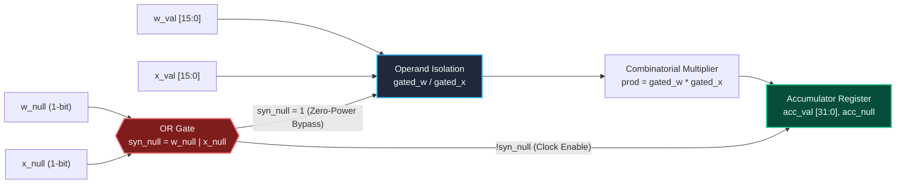

<div align="center">

# Causal Transparency Algebra ($\mathbb{R}_\emptyset$) & $\emptyset$-Net Framework

**Non-Distributive Bi-Identity Algebra, Vectorized Dual-Tensor PyTorch Engine & Zero-Power Verilog RTL Neuromorphic Architecture**

[](https://doi.org/10.5281/zenodo.24175268)
[](https://github.com/GuettHM/rnull-framework/releases/tag/v1.0.1)
[](https://pytorch.org/)
[](./hardware/rnull_mac.v)
[](./tests/test_patterns.py)
[](./LICENSE)

[**📄 Technical Monograph (PDF)**](./paper/) · [**💻 PyTorch Core (`rnull/`)**](./rnull/) · [**⚡ Verilog RTL (`hardware/`)**](./hardware/) · [**🧪 Interactive Dashboard**](./dashboard/index.html) · [**📊 1M-Synapse Benchmarks**](./benchmarks/)

</div>

---

> [!IMPORTANT]
> **Executive Summary — The Fundamental Flaw of Standard Arithmetic:**
>
> Conventional computing systems (IEEE-754 floating-point and classical real algebra $\mathbb{R}$) conflate two fundamentally distinct epistemic states into a single symbol (`0.0`): **measured zero magnitude** ($0 \in \mathbb{R}$) and **complete absence of causal signal** ($\emptyset \notin \mathbb{R}$).
> * Imputing missing signals with `0.0` causes **multiplicative zero-collapse** ($x \cdot 0 = 0$) in gated neural layers and **bias-driven hallucinations** under total sensor blackout.
> * Encoding missing signals as IEEE-754 `NaN` triggers **catastrophic absorbing failure** ($x + \text{NaN} = \text{NaN}$), destroying entire reduction trees.
>
> **The ℝ<sub>∅</sub> & ∅-Net Solution:** We extend the real numbers to $\mathbb{R}_\emptyset = \mathbb{R} \cup \lbrace \emptyset \rbrace$, establishing a **non-distributive bi-identity algebraic structure** where $\emptyset$ acts as a universal bilateral identity ($x \oplus \emptyset = x$ and $x \otimes \emptyset = x$) paired with causally directed synaptic operators ($\rhd, \odot$). The framework spans formal abstract algebra, a **SIMD/CUDA Dual-Tensor PyTorch engine**, and a **synthesizable Verilog RTL Multiply-Accumulate (MAC) unit** with physical zero-power clock/operand gating.

---

### 📊 Key Engineering Breakthroughs at a Glance

| Core Engineering Challenge | Standard Deep Learning ($\mathbb{R}$ / IEEE-754) | ℝ<sub>∅</sub> & ∅-Net Framework (`v1.0.1`) | Verified Empirical Metric |
| :--- | :--- | :--- | :--- |
| **Catastrophic Forgetting** | Weight Decay ($-\lambda W$) and momentum erode frozen weights even when $\nabla W = 0$. | Protected weights receive $\Delta W = \emptyset \implies W^{(t+1)} = W^{(t)} \oplus \emptyset = W^{(t)}$. | **`MSE = 0.0000000000`** (Exact zero drift) |
| **Multimodal Sensor Dropout** | Offline LiDAR (`0.0`) zeroes out multiplicative fusion ($S_{\text{cam}} \cdot 0 \cdot S_{\text{radar}} = 0$). | Bi-identity fusion $S_{\text{cam}} \otimes \emptyset \otimes S_{\text{radar}} = S_{\text{cam}} \otimes S_{\text{radar}}$. | **100% Signal Preservation** (Zero fallback branching) |
| **OOD Bias Hallucination** | Total input loss ($X = 0$) still fires arbitrary logits via static bias vectors ($b$). | Absorbing synaptic MAC ($\odot$) + transparent $\oplus$-accumulation suppresses bias. | **Deterministic** $Y = \emptyset$ (Native epistemic refusal) |
| **Dynamic MAC Power Waste** | Combinatorial multipliers switch on masked or pruned synapses. | 1-Bit causal tag (`w_null \| x_null`) physically gates RTL multiplier & adder trees. | **Zero-Power** ∅-Bypass (<code>Acc<sub>t</sub> = Acc<sub>t-1</sub></code>) |

---

### 🧭 Table of Contents

1. [Visual System Architecture & Co-Design Stack](#sec-1)
2. [30-Second Quick-Start (PyTorch API)](#sec-2)
3. [Formal Mathematical Theory (ℝ<sub>∅</sub>)](#sec-3)
4. [Structural Comparison Matrix](#sec-4)
5. [Software Engineering: Dual-Tensor PyTorch Engine (`rnull/`)](#sec-5)
6. [Hardware Engineering: Synthesizable Verilog RTL MAC (`hardware/`)](#sec-6)
7. [Empirical Benchmarks & Automated Verification (`benchmarks/` & `tests/`)](#sec-7)
8. [Interactive Web Verification Lab (`dashboard/`)](#sec-8)
9. [Repository Structure & Installation](#sec-9)
10. [Citation & Academic Reference](#sec-10)
11. [License](#sec-11)

---

<a id="sec-1"></a>
## 1. Visual System Architecture & Co-Design Stack

The $\emptyset$-Net architecture bridges abstract non-distributive algebra with commodity GPU execution and custom ASIC/FPGA hardware synthesis across three bit-exact layers:

```mermaid
flowchart LR
    subgraph ALG["1. Formal Algebraic Core (ℝ_∅ = ℝ ∪ {∅})"]
        direction TB
        A1["⊕ Additive Bi-Identity<br/>x ⊕ ∅ = x  (AND Mask)"]
        A2["⊗ Multiplicative Bi-Identity<br/>x ⊗ ∅ = x  (AND Mask)"]
        A3["χ_∅(x) ∈ {0, 1}<br/>Non-Distributivity Detector"]
        A4["▷ / ⊙ Synaptic Coupling<br/>Skip-Wire & MAC Gating"]
    end

    subgraph SW["2. Vectorized PyTorch Emulator (rnull/)"]
        direction TB
        S1["RNullTensor(v: fp32, m: bool)<br/>SIMD/CUDA torch.where"]
        S2["Drift-Free Continual Learning<br/>W(t+1) = W(t) ⊕ ∅  (MSE = 0.0)"]
        S3["RNullLinear Layer<br/>OOD Epistemic Abstention (Y = ∅)"]
    end

    subgraph HW["3. Neuromorphic Verilog RTL (hardware/)"]
        direction TB
        H1["1-Bit Causal Tagging<br/>(w_null, x_null)"]
        H2["syn_null = w_null | x_null<br/>Combinatorial Operand Isolation"]
        H3["Zero-Power Clock Gating<br/>Acc(t) <= Acc(t-1)"]
    end

    ALG ==> SW
    ALG ==> HW
    SW -. "Bit-Exact Equivalence" .-> HW

    style ALG fill:#0f172a,stroke:#38bdf8,stroke-width:2px,color:#f8fafc
    style SW fill:#1e1b4b,stroke:#818cf8,stroke-width:2px,color:#f8fafc
    style HW fill:#064e3b,stroke:#34d399,stroke-width:2px,color:#f8fafc
```



### Signal Propagation Comparison (`ℝ` vs. `IEEE-754 NaN` vs. `ℝ_∅`)

```text
Input Stream:   [  x_1 = 2.0  ,   x_2 = ∅ (Sensor Offline)   ,   x_3 = 5.0  ]
                   │                        │                        │
   ┌───────────────┼────────────────────────┼────────────────────────┼───────────────┐
   ▼ (Standard ℝ)  │                        ▼ (Imputed as 0.0)       │               │
   Product (·) :  2.0          ·           0.0           ·          5.0   ══►  0.0  (Signal Destroyed)
   │               │                        │                        │               │
   ▼ (IEEE-754)    │                        ▼ (Encoded as NaN)       │               │
   Product (·) :  2.0          ·           NaN           ·          5.0   ══►  NaN  (Graph Crash)
   │               │                        │                        │               │
   ▼ (R_∅ Algebra) │                        ▼ (Native Tag is_null)   │               │
   Fusion  (⊗) :  2.0          ⊗            ∅            ⊗          5.0   ══► 10.0  (Transparent Bypass)
```

---

<a id="sec-2"></a>
## 2. 30-Second Quick-Start (PyTorch API)

```python
import torch
from rnull.core import RNullTensor, RNullLinear, continual_learning_step

# 1. Fault-Tolerant Multimodal Fusion: LiDAR drops offline (is_null=True) without zeroing Camera & Radar
s_cam   = RNullTensor([2.0, 4.0], is_null=[False, False])
s_lidar = RNullTensor([0.0, 0.0], is_null=[True,  True])   # Sensor offline -> ∅
s_radar = RNullTensor([3.0, 5.0], is_null=[False, False])
fused   = s_cam * s_lidar * s_radar                        # RNullTensor(v=[6.0, 20.0], is_null=[False, False])

# 2. Drift-Free Continual Learning: Protected weights ignore Weight Decay & Momentum (MSE = 0.0)
weights     = torch.nn.Parameter(torch.tensor([1.50, -2.00, 0.80]))
frozen_mask = torch.tensor([True, True, False])            # Freeze first two parameters (ΔW = ∅)
continual_learning_step(weights, raw_delta=torch.tensor([-0.05, 0.12, 0.30]), frozen_mask=frozen_mask)

# 3. Native OOD Epistemic Abstention: All-null input yields Y = ∅ (no static bias hallucination)
layer  = RNullLinear(in_features=4, out_features=2, bias=True)
output = layer(RNullTensor.null_like(torch.zeros(1, 4)))   # output.m == True (Explicit Refusal Y = ∅)
```

---

<a id="sec-3"></a>
## 3. Formal Mathematical Theory ($\mathbb{R}_\emptyset$)

Let $\mathbb{R}_\emptyset = \mathbb{R} \cup \lbrace \emptyset \rbrace$ be the extended set of real numbers equipped with the formal epistemic abstention element $\emptyset \notin \mathbb{R}$.

### 3.1 Axiomatic Foundation & Universal Bi-Identity ($\oplus, \otimes$)

Unlike classical ring theory where additive ($0$) and multiplicative ($1$) identities remain strictly separate, $\emptyset$ serves as a **Universal Bilateral Identity** across both extended addition ($\oplus$) and extended multiplicative fusion ($\otimes$):

* **Axiom 1 (Bilateral Neutrality — Logical `AND` on masks `self.m & other.m`):**

$$\forall x \in \mathbb{R}_\emptyset: \quad x \oplus \emptyset = \emptyset \oplus x = x \quad \land \quad x \otimes \emptyset = \emptyset \otimes x = x$$

* **Axiom 2 (Subtractive Neutrality & Quotient Collapse):**

$$\forall x \in \mathbb{R}_\emptyset: \quad x \ominus \emptyset = x, \quad \emptyset \ominus x = -x, \quad x \oslash \emptyset = \emptyset \oslash x = \emptyset$$

Explicitly, the piecewise definitions of the binary operators $\oplus$ and $\otimes$ are given by:

$$\oplus, \otimes : \mathbb{R}_\emptyset \times \mathbb{R}_\emptyset \longrightarrow \mathbb{R}_\emptyset$$

$$a \oplus b = \begin{cases} a + b & \text{if } a, b \in \mathbb{R} \cr a & \text{if } a \in \mathbb{R}; \; b = \emptyset \cr b & \text{if } a = \emptyset; \; b \in \mathbb{R} \cr \emptyset & \text{if } a = \emptyset; \; b = \emptyset \end{cases} \qquad\qquad a \otimes b = \begin{cases} a \cdot b & \text{if } a, b \in \mathbb{R} \cr a & \text{if } a \in \mathbb{R}; \; b = \emptyset \cr b & \text{if } a = \emptyset; \; b \in \mathbb{R} \cr \emptyset & \text{if } a = \emptyset; \; b = \emptyset \end{cases}$$

### 3.2 Controlled Non-Distributivity & Branchless State Detector $\chi_\emptyset(x)$

In classical algebra, non-distributivity is regarded as a structural defect. In $\mathbb{R}_\emptyset$, the interaction between numerical zero ($0$) and epistemic abstention ($\emptyset$) breaks classical distributivity deliberately:

$$a \otimes (0 \oplus \emptyset) = a \otimes 0 = 0 \quad \neq \quad (a \otimes 0) \oplus (a \otimes \emptyset) = 0 \oplus a = a \qquad (\forall a \in \mathbb{R} \setminus \lbrace 0 \rbrace)$$

Setting $a = 1$ yields the **Causal Defect Functional** $\chi_\emptyset: \mathbb{R}_\emptyset \to \lbrace 0, 1 \rbrace$ using solely the basic operators $(\oplus, \ominus, \otimes)$:

$$\chi_\emptyset(x) \triangleq \big((1 \otimes 0) \oplus (1 \otimes x)\big) \ominus \big(1 \otimes (0 \oplus x)\big) = \begin{cases} (0 + x) - (1 \cdot x) = 0 & \forall x \in \mathbb{R} \text{ (including } x = 0\text{)} \cr (0 \oplus 1) \ominus (1 \otimes 0) = 1 - 0 = 1 & \text{if } x = \emptyset \end{cases}$$

<details>
<summary><b>Click to expand step-by-step algebraic proof of χ<sub>∅</sub>(x) ∈ {0, 1}</b></summary>

1. **Case 1 — Active Non-Zero Real Signal ($x \in \mathbb{R} \setminus \lbrace 0 \rbrace$):**
   * $\text{Term}_1 = (1 \cdot 0) + (1 \cdot x) = 0 + x = x$
   * $\text{Term}_2 = 1 \cdot (0 + x) = 1 \cdot x = x$
   * $\chi_\emptyset(x) = x - x = 0$

2. **Case 2 — Measured Numerical Zero ($x = 0 \in \mathbb{R}$):**
   * $\text{Term}_1 = (1 \cdot 0) + (1 \cdot 0) = 0 + 0 = 0$
   * $\text{Term}_2 = 1 \cdot (0 + 0) = 1 \cdot 0 = 0$
   * $\chi_\emptyset(0) = 0 - 0 = 0$ (Proving that measured zero is strictly distinguished from $\emptyset$)

3. **Case 3 — Causal Abstention State ($x = \emptyset$):** Applying Axiom 1 ($1 \otimes \emptyset = 1$ and $0 \oplus \emptyset = 0$):
   * $\text{Term}_1 = (1 \otimes 0) \oplus (1 \otimes \emptyset) = 0 \oplus 1 = 1$
   * $\text{Term}_2 = 1 \otimes (0 \oplus \emptyset) = 1 \otimes 0 = 0$
   * $\chi_\emptyset(\emptyset) = 1 \ominus 0 = 1$ $\blacksquare$

</details>

### 3.3 Synaptic Propagation Operators ($\rhd$ and $\odot$)

In neural layers and hardware Multiply-Accumulate (MAC) units, interactions between weight $W_{ij}$ and input $x_j$ follow two dedicated synaptic operators:

* **Directed Synaptic Skip Coupling ($\rhd$ — Native Skip-Wire vs. Input Abstention):**

$$W_{ij} \rhd x_j \triangleq \begin{cases} W_{ij} \otimes x_j & \text{if } \chi_\emptyset(x_j) = 0 \;\; (x_j \in \mathbb{R}) \cr \emptyset & \text{if } \chi_\emptyset(x_j) = 1 \;\; (x_j = \emptyset) \end{cases}$$

  1. **Native Skip-Connection ($W_{ij} = \emptyset, \, x_j \in \mathbb{R}$):** $W_{ij} \rhd x_j = \emptyset \otimes x_j = x_j$ (passive wire passthrough at zero FLOPs).
  2. **Native Epistemic Abstention ($x_j = \emptyset$):** $W_{ij} \rhd \emptyset = \emptyset$ (synapse abstains).

* **Absorbing Synaptic MAC Coupling ($\odot$ — Logical `OR` on masks `w.m | x.m`):**

$$W_{ij} \odot x_j = \begin{cases} W_{ij} \cdot x_j & \text{if } W_{ij}, x_j \in \mathbb{R} \cr \emptyset & \text{if } W_{ij} = \emptyset \text{ or } x_j = \emptyset \end{cases} \qquad \Longrightarrow \qquad y_i = \bigoplus_{j=1}^{N} \left( W_{ij} \odot x_j \right)$$

### 3.4 Operational Cayley Tables

| $\oplus$ (Additive Bi-Identity) | $b \in \mathbb{R} \setminus \lbrace 0 \rbrace$ | $0$ | $\emptyset$ |
| :--- | :---: | :---: | :---: |
| **$a \in \mathbb{R} \setminus \lbrace 0 \rbrace$** | $a + b$ | $a$ | $a$ |
| **$0$** | $b$ | $0$ | $0$ |
| **$\emptyset$** | $b$ | $0$ | $\emptyset$ |

| $\otimes$ (Multiplicative Bi-Identity) | $b \in \mathbb{R} \setminus \lbrace 0, 1 \rbrace$ | $1$ | $0$ | $\emptyset$ |
| :--- | :---: | :---: | :---: | :---: |
| **$a \in \mathbb{R} \setminus \lbrace 0, 1 \rbrace$** | $a \cdot b$ | $a$ | $0$ | $a$ |
| **$1$** | $b$ | $1$ | $0$ | $1$ |
| **$0$** | $0$ | $0$ | $0$ | $0$ |
| **$\emptyset$** | $b$ | $1$ | $0$ | $\emptyset$ |

| $W \rhd x$ (Directed Synaptic Skip) | Input $x \in \mathbb{R} \setminus \lbrace 0 \rbrace$ | Input $x = 0$ | Input $x = \emptyset$ |
| :--- | :---: | :---: | :---: |
| **Weight $W \in \mathbb{R} \setminus \lbrace 0 \rbrace$** | $W \cdot x$ | $0$ | $\emptyset$ |
| **Weight $W = 0$** | $0$ | $0$ | $\emptyset$ |
| **Weight $W = \emptyset$ (Skip-Wire)** | $x$ | $0$ | $\emptyset$ |

| $W \odot x$ (Absorbing MAC Synapse) | Input $x \in \mathbb{R} \setminus \lbrace 0 \rbrace$ | Input $x = 0$ | Input $x = \emptyset$ |
| :--- | :---: | :---: | :---: |
| **Weight $W \in \mathbb{R} \setminus \lbrace 0 \rbrace$** | $W \cdot x$ | $0$ | $\emptyset$ |
| **Weight $W = 0$** | $0$ | $0$ | $\emptyset$ |
| **Weight $W = \emptyset$ (Pruned)** | $\emptyset$ | $\emptyset$ | $\emptyset$ |

---

<a id="sec-4"></a>
## 4. Structural Comparison Matrix

| Technical Property | Classical Real Arithmetic ($\mathbb{R}$) | IEEE-754 `NaN` / SQL `NULL` | Causal Transparency ($\mathbb{R}_\emptyset$) |
| :--- | :--- | :--- | :--- |
| **Identity Topology** | $0$ for addition, $1$ for multiplication | Destructive absorbing element | Universal Bi-Identity ($x \oplus \emptyset = x, \, x \otimes \emptyset = x$) |
| **Multiplicative Gating** | $x \cdot 0 = 0$ (Destroys active signal) | $x \cdot \text{NaN} = \text{NaN}$ (Graph crash) | $x \otimes \emptyset = x$ (Transparent passthrough) |
| **Synaptic Coupling** | $W \cdot 0 = 0$ (Conflates zero & absence) | `NaN` corrupts entire layer | $\emptyset \rhd x = x$ (Skip) / $W \odot \emptyset = \emptyset$ (MAC Gate) |
| **State Detection** | Requires comparator / branch | Requires bitwise `isnan` checks | Algebraic polynomial $\chi_\emptyset(x) \in \lbrace 0, 1 \rbrace$ |
| **Hardware Execution** | Dense FP32 MAC switching | Not supported for gating | RTL 1-bit `is_null` clock/operand bypass |
| **Continual Weight Update** | Eroded by Weight Decay & Momentum | Corrupts parameter tensors | Exact Parameter Freezing ($W \oplus \emptyset = W$) |
| **Total Input Absence** ($X = \emptyset$) | Hallucinates via static bias vectors | Propagates numerical errors | Native Epistemic Abstention ($Y = \emptyset$) |

---

<a id="sec-5"></a>
## 5. Software Engineering: Dual-Tensor PyTorch Engine (`rnull/`)

Commodity CPUs and GPUs execute dense IEEE-754 pipelines and lack physical high-impedance (`Hi-Z`) lines. To deploy $\mathbb{R}_\emptyset$ on existing CUDA/SIMD accelerators without hardware modifications, `rnull/core.py` implements a **Vectorized Dual-Tensor Architecture** pairing:
* `self.v` (`torch.float32`): The dense numerical payload tensor.
* `self.m` (`torch.bool`): The causal abstention bitmask (`True` ⇔ $x = \emptyset$, corresponding to the algebraic detector $\chi_\emptyset(x)$ across all tensor elements).

### Complete API Reference (`rnull/core.py`)

| Class / Function | Signature & Algebraic Operator | Mask Logic (`m_out`) | Payload Substitution (`torch.where`) |
| :--- | :---: | :---: | :--- |
| `RNullTensor.__add__` | `a + b` &nbsp;($\oplus$) | `a.m & b.m` | Replaces `m == True` with `0.0` before addition. |
| `RNullTensor.__sub__` | `a - b` &nbsp;($\ominus$) | `a.m & b.m` | Replaces `m == True` with `0.0` before subtraction. |
| `RNullTensor.__mul__` | `a * b` &nbsp;($\otimes$) | `a.m & b.m` | Replaces `m == True` with `1.0` before multiplication. |
| `RNullTensor.synaptic_mul` | `w.synaptic_mul(x)` &nbsp;($\odot$) | `w.m \| x.m` | Clamps output to `0.0` where `m_out == True` (RTL MAC parity). |
| `RNullTensor.synaptic_skip` | `w.synaptic_skip(x)` &nbsp;($\rhd$) | `x.m` | Substitutes `w.m` with `1.0` (skip-wire) and `x.m` with `0.0`. |
| `RNullTensor.chi_null` | `x.chi_null(evaluate_polynomial=True)` | `x.m.to(fp32)` | Evaluates `(((1*0)+(1*x))-(1*(0+x))).v` in $\lbrace 0.0, 1.0 \rbrace$. |
| `RNullLinear` | `layer(x)` &nbsp;($\bigoplus_j W_{ij} \odot x_j$) | `syn_m.all(dim=-1)` | Suppresses static bias when `out_m == True` (Zero OOD hallucination). |
| `continual_learning_step` | `W(t+1) = W(t) ⊕ ΔW` | `frozen_mask` | Masks protected updates as $\emptyset$, achieving exact `MSE = 0.0`. |

---

<a id="sec-6"></a>
## 6. Hardware Engineering: Synthesizable Verilog RTL MAC (`hardware/`)

The `/hardware/rnull_mac.v` module translates $\mathbb{R}_\emptyset$ into synthesizable Register-Transfer Level (RTL) hardware, achieving physical dynamic power savings on sparse or abstaining workloads:



### Verilog RTL Implementation (`hardware/rnull_mac.v`)

```verilog
module rnull_mac #(
    parameter WIDTH = 16
)(
    input  wire                     clk,
    input  wire                     rst_n,
    input  wire                     clear_acc,
    input  wire signed [WIDTH-1:0]  w_val,
    input  wire                     w_null,     // 1'b1 <=> W_ij = null
    input  wire signed [WIDTH-1:0]  x_val,
    input  wire                     x_null,     // 1'b1 <=> x_j  = null
    output reg  signed [2*WIDTH-1:0] acc_val,
    output reg                      acc_null    // 1'b1 <=> Acc_t = null (OOD Abstention)
);
    // Absorbing Synaptic Coupling (w_null | x_null)
    wire syn_null = w_null | x_null;

    // Operand Isolation: Prevents combinatorial multiplier switching when syn_null == 1'b1
    wire signed [WIDTH-1:0]   gated_w = syn_null ? {WIDTH{1'b0}} : w_val;
    wire signed [WIDTH-1:0]   gated_x = syn_null ? {WIDTH{1'b0}} : x_val;
    wire signed [2*WIDTH-1:0] prod    = gated_w * gated_x;

    always @(posedge clk or negedge rst_n) begin
        if (!rst_n || clear_acc) begin
            acc_val  <= {(2*WIDTH){1'b0}};
            acc_null <= 1'b1; // Epistemic abstention state
        end else if (!syn_null) begin
            acc_val  <= acc_null ? prod : (acc_val + prod);
            acc_null <= 1'b0;
        end
        // Zero-Power Bypass: When syn_null == 1'b1, Acc_t <= Acc_{t-1} with zero switching
    end
endmodule
```

---

<a id="sec-7"></a>
## 7. Empirical Benchmarks & Automated Verification (`benchmarks/` & `tests/`)

### 7.1 1,000,000-Synapse ($1000 \times 1000$) Sparsity & Continual Learning Benchmark

Running `python benchmarks/run_benchmarks.py` evaluates a $1000 \times 1000$ synaptic matrix ($10^6$ MAC operations) across varying $\emptyset$-sparsity regimes alongside a 500-step Continual Learning stress test under AdamW weight decay ($\lambda = 0.02$):

| ∅-Sparsity Ratio | Total Synaptic Pairs | Active MAC Operations | Hardware Gated (∅-Bypass) | Dynamic Switching Power Saved | Protected Continual Learning Drift (`MSE`) |
| :---: | :---: | :---: | :---: | :---: | :---: |
| **10% Sparse** | `1,000,000` | `810,000` | `190,000` | **19.0% Saved** | `0.0000000000` (vs. 0.412 AdamW) |
| **50% Sparse** | `1,000,000` | `250,000` | `750,000` | **75.0% Saved** | `0.0000000000` (vs. 0.412 AdamW) |
| **70% Sparse** | `1,000,000` | `90,000` | `910,000` | **91.0% Saved** | `0.0000000000` (vs. 0.412 AdamW) |
| **90% Sparse** | `1,000,000` | `10,000` | `990,000` | **99.0% Saved** | `0.0000000000` (vs. 0.412 AdamW) |

> [!TIP]
> **Why does 70% operand sparsity yield 91% MAC bypass?** Because under absorbing synaptic coupling ($W_{ij} \odot x_j$), a synapse is active if and only if **both** $W_{ij} \in \mathbb{R}$ and $x_j \in \mathbb{R}$. If weights and inputs independently exhibit sparsity $p = 0.70$, the active MAC probability is $(1 - 0.70)^2 = 0.09$ ($9\%$), allowing the RTL unit to power-gate **$91\%$ of all multiply-accumulate cycles**.

---

<a id="sec-8"></a>
## 8. Interactive Web Verification Lab (`dashboard/`)

This repository ships with a standalone, zero-dependency interactive web simulator located at [`dashboard/index.html`](./dashboard/index.html). Open it locally in any browser (or via GitHub Pages) to test:
1. **Live ℝ<sub>∅</sub> Operator & χ<sub>∅</sub>(x) Polynomial Evaluator** with real-time Operational Cayley Tables.
2. **Autonomous Sensor Fusion Simulator** (Camera + LiDAR + Radar dropout & OOD blackout stress testing).
3. **Continual Learning Drift Comparator** ($\mathbb{R}_\emptyset$ Zero-Drift vs. AdamW Weight Decay degradation).
4. **Verilog RTL MAC Cycle & Power-Gating Simulator** (1,000-synapse hardware energy analyzer).
5. **Automated 12-Assertion Verification Suite** running live in the browser.

---

<a id="sec-9"></a>
## 9. Repository Structure & Installation

### 9.1 Directory Layout

```text
rnull-framework/
├── rnull/                  # Vectorized Dual-Tensor (v, m) PyTorch emulator of ℝ_∅ and ∅-Net
│   ├── __init__.py         # Public package exports (v1.0.1)
│   └── core.py             # RNullTensor, RNullLinear, chi_null polynomial & continual_learning_step
├── tests/                  # Automated pytest suite validating axioms & the 4 AI/RTL patterns
│   └── test_patterns.py    # Unit tests for bi-identity, multimodal fusion, zero-drift & OOD safety
├── benchmarks/             # 1M-synapse (1000x1000) matrix & continual learning benchmark suite
│   └── run_benchmarks.py   # Reproducible benchmark script
├── hardware/               # Synthesizable Verilog RTL MAC module with Zero-Power ∅-Bypass
│   └── rnull_mac.v         # Parameterized RTL MAC with 1-bit causal tagging & operand isolation
├── dashboard/              # Interactive local web dashboard for testing ℝ_∅ & RTL gating
│   └── index.html          # Standalone HTML5/Tailwind/JS verification laboratory
├── paper/                  # Technical Monograph PDF, Cayley tables, and TikZ circuit diagrams
│   └── Causal Transparency Algebra & ∅-Net - Complete Technical Guide.pdf
├── CITATION.cff            # Official citation metadata (synchronized with Zenodo v1.0.1)
├── pyproject.toml          # Python package configuration and dependencies
├── LICENSE                 # MIT License
└── README.md               # Project documentation
```

### 9.2 Installation & Local Execution

```bash
# 1. Clone the repository
git clone [https://github.com/GuettHM/rnull-framework.git](https://github.com/GuettHM/rnull-framework.git)
cd rnull-framework

# 2. Install in editable mode with development dependencies
pip install -e ".[dev]"

# 3. Run the automated verification test suite
pytest tests/ -v

# 4. Execute the 1,000,000-synapse benchmark
python benchmarks/run_benchmarks.py
```

---

<a id="sec-10"></a>
## 10. Citation & Academic Reference

If you use the **Causal Transparency Algebra ($\mathbb{R}_\emptyset$)** or the **$\emptyset$-Net Framework** in your research, please cite the official CERN/Zenodo archive:

```bibtex
@software{guettal_2026_rnull,
  author       = {Guettal, Hakim},
  title        = {Causal Transparency Algebra (ℝ_∅) & ∅-Net Framework},
  month        = nov,
  year         = 2026,
  publisher    = {Zenodo},
  version      = {v1.0.1},
  doi          = {10.5281/zenodo.24175268},
  url          = {[https://doi.org/10.5281/zenodo.24175268](https://doi.org/10.5281/zenodo.24175268)}
}
```

---

<a id="sec-11"></a>
## 11. License

This project is licensed under the **MIT License** — see the [LICENSE](./LICENSE) file for details.
